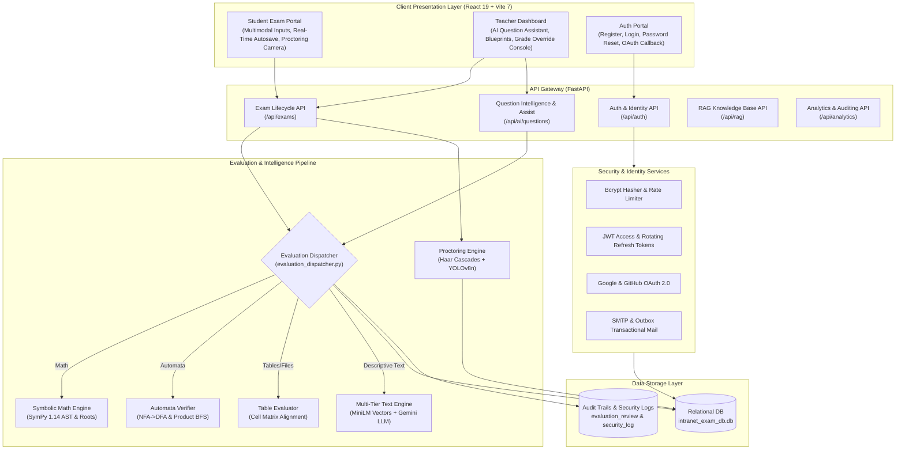

# 🎓 QIS — AI-Assisted Assessment Intelligence Platform

[](https://www.python.org/downloads/)
[](https://fastapi.tiangolo.com/)
[](https://reactjs.org/)
[](https://vitejs.dev/)
[](https://www.sympy.org/)
[](https://huggingface.co/sentence-transformers/all-MiniLM-L6-v2)
[](LICENSE)

An enterprise-grade, privacy-first examination and assessment intelligence system engineered for academic institutions and universities. QIS integrates **deterministic symbolic mathematics**, **formal automata theory verification**, **dense semantic text embeddings**, **continuous computer vision proctoring**, **curriculum-aligned blueprint assembly**, and an **enterprise-grade authentication ecosystem** — while strictly maintaining educators in complete authoritative control.

---

## 📑 Table of Contents

- [Architecture Overview](#-architecture-overview)
- [System Architecture Diagram](#-system-architecture-diagram)
- [Core Subsystems & Key Features](#-core-subsystems--key-features)
  - [1. Multi-Format Subjective Evaluation Engine](#1-multi-format-subjective-evaluation-engine)
  - [2. Enterprise Authentication & Identity Architecture](#2-enterprise-authentication--identity-architecture)
  - [3. Continuous AI Proctoring & Integrity Telemetry](#3-continuous-ai-proctoring--integrity-telemetry)
  - [4. Blueprint-Based Examination Assembly](#4-blueprint-based-examination-assembly)
  - [5. Teacher AI Question Authoring Assistant](#5-teacher-ai-question-authoring-assistant)
  - [6. Academic Analytics & Performance Reporting](#6-academic-analytics--performance-reporting)
- [Technology Stack](#-technology-stack)
- [Repository Structure](#-repository-structure)
- [Installation & Quickstart](#-installation--quickstart)
  - [Prerequisites](#prerequisites)
  - [Backend Setup](#1-backend-setup)
  - [Frontend Setup](#2-frontend-setup)
- [Environment Configuration (.env)](#-environment-configuration-env)
- [Automated Testing & Verification Benchmarks](#-automated-testing--verification-benchmarks)
- [API Reference](#-api-reference)
  - [Authentication & Identity](#authentication--identity)
  - [Examination Lifecycle & Submissions](#examination-lifecycle--submissions)
  - [Question Intelligence & Authoring](#question-intelligence--authoring)
  - [Knowledge Base & RAG](#knowledge-base--rag)
  - [Analytics & Integrity Auditing](#analytics--integrity-auditing)
- [Security & Integrity Architecture](#-security--integrity-architecture)
- [Audit & Technical Documentation Directory](#-audit--technical-documentation-directory)
- [License](#-license)

---

## 🏛 Architecture Overview

QIS operates on a **Layered Service-Oriented Architecture (SOA)** governed by the core philosophy: **"Determinism Where Possible, AI Where Necessary"**.

```
[ Presentation Layer ]  React 19 SPA + Tailwind CSS + Lucide Icons + Vite 7
         │
         ▼
[ API Gateway Layer ]   FastAPI Async ASGI + OAuth2 Bearer / Cookie Auth + Sliding Rate Limiter
         │
         ├──► [ Security & Auth ]    Bcrypt Hashing + Refresh Token Rotation + OAuth 2.0 (Google/GitHub)
         ├──► [ Evaluation Dispatcher ] Deterministic (SymPy / Automata BFS / Tables) + Neural (MiniLM / Gemini)
         ├──► [ Proctoring Telemetry ] Haar Cascades (Face) + YOLOv8 (Phones/Laptops) + Browser Integrity
         ├──► [ Blueprint Engine ]   Multi-Constraint Integer Knapsack Solver (Bloom & Difficulty Quotas)
         └──► [ RAG Knowledge Base ] Recursive Chunking + 384-d Dense Vector Search
         │
         ▼
[ Persistence Layer ]   SQLite (WAL Mode) / PostgreSQL + Transactional Connection Pooling
```

1. **Presentation Layer (Frontend)**: React 19 SPA running on Vite 7 and React Router 7. Features tabbed multimodal answer editors (KaTeX LaTeX rendering, interactive DFA/NFA state builders, truth table grids, and file uploads), teacher blueprint design wizards, and human-in-the-loop grade override consoles.
2. **API Gateway Layer (Backend)**: FastAPI asynchronous REST API providing JWT bearer authentication, role-based access control (Student vs Teacher vs Admin), sliding-window rate limiting, and input sanitization.
3. **Multi-Domain Intelligence Engine**:
   - **Symbolic Math Evaluator**: SymPy 1.14 AST parser verifying algebraic equivalences, polynomial factoring, and equation root sets without unsafe `eval()`.
   - **Automata Verifier**: Formal 5-tuple structural validation, subset construction ($NFA \to DFA$), and Product Automaton Breadth-First Search (BFS) language equivalence.
   - **Multi-Tier Semantic Evaluator**: Tier 1 Google Gemini LLM with anti-injection prompt isolation; Tier 2 local SentenceTransformers (`all-MiniLM-L6-v2`) embeddings with clause coverage; Tier 3 sequence matching.
   - **Computer Vision Proctoring**: Real-time Haar Cascade facial orientation tracking coupled with YOLOv8n object detection (mobile phones, secondary screens).
4. **Authoritative Persistence Layer**: Centralized relational database with foreign key enforcement, cascade isolation, immutable evaluation audit trails (`EvaluationReview`), and security event logs (`SecurityLog`).

---

## 📊 System Architecture Diagram



---

## ✨ Core Subsystems & Key Features

### 1. Multi-Format Subjective Evaluation Engine

QIS eliminates the fundamental limitation of traditional CBT platforms by enabling students to submit non-MCQ solutions across multiple disciplines:

- **Symbolic Mathematics & Algebra (`math_evaluator.py`)**:
  - Uses `SymPy 1.14` symbolic algebra trees to evaluate factored polynomials ($(x-2)(x-3) \equiv (x-3)(x-2)$), trigonometric identities ($\sin^2(x) + \cos^2(x) \equiv 1$), expanded polynomials, and algebraic derivations.
  - Compares equation root sets symbolically rather than using fragile string equality.
  - Zero usage of Python's dangerous `eval()` or `exec()` — AST parsing strictly sandboxed.
- **Formal Automata & State Machines (`automata_evaluator.py`)**:
  - Full structural validation of formal 5-tuples ($Q, \Sigma, \delta, q_0, F$).
  - Supports both **DFA** and **NFA** submissions with $\epsilon$-closure computation and subset construction.
  - Computes formal language equivalence ($L(M_1) \equiv L(M_2)$) via **Product Automata Breadth-First Search (BFS)**; automatically returns counterexample input strings if languages diverge.
- **Structured Tabular Matrices (`diagram_evaluator.py`)**:
  - Compares student truth tables, scheduling grids, or state-transition tables cell-by-cell and row-by-row against teacher answer keys with proportional mark allocation.
  - Digital PDF text extraction via `pypdf` with automatic scanned-document routing.
- **Multi-Tier Descriptive Text Evaluation (`text_evaluator.py`)**:
  - **Tier 1 (Cloud AI)**: Google Gemini 1.5 Flash with prompt injection delimiters (`<<<STUDENT_ANSWER>>>`) and strict JSON schema output.
  - **Tier 2 (Local Semantic Embedding)**: 384-dimensional dense vectors via `all-MiniLM-L6-v2` with cosine similarity and rubric clause keyphrase extraction.
  - **Tier 3 (Deterministic Fallback)**: `difflib.SequenceMatcher` lexical alignment ensuring 100% offline grading capability if network connectivity fails.
- **Human-in-the-Loop Grade Override (`EvaluationReview`)**:
  - All automated marks are confidence-scored. Scores with confidence $<0.70$ are flagged as `NEEDS_REVIEW`.
  - Teachers can review student working, adjust marks with server-side range clamping ($0.0 \le \text{marks} \le \text{max\_marks}$), and record immutable audit records.

---

### 2. Enterprise Authentication & Identity Architecture

A production-grade authentication ecosystem engineered to OWASP application security standards:

- **Password Security**: Modern `bcrypt` password hashing with backward compatibility for legacy hashes.
- **Dual-Token Lifecycle**: Short-lived JWT access tokens (30 minutes) paired with cryptographic rotating refresh tokens (7 days standard, 30 days for "remember me" sessions).
- **Self-Service Registration & Verification**: User registration with student/teacher role selection and automated enrollment ID allocation (`ENR...`), supported by email verification tokens with local transactional outbox logging (`mail_outbox.jsonl`).
- **Self-Service Password Recovery**: Secure password reset flow with expiring single-use verification tokens.
- **Social Sign-In (OAuth 2.0)**: Google and GitHub OpenID Connect/OAuth integration with anti-CSRF state token validation.
- **Brute-Force & Attack Defenses**: Sliding-window IP and account rate limiting (5 consecutive failed attempts trigger a 15-minute lockout). All authentication actions are permanently logged in `SecurityLog`.

---

### 3. Continuous AI Proctoring & Integrity Telemetry

- **Browser Integrity**: Real-time tracking of browser focus blurs, fullscreen exits, tab switches, and unauthorized external clipboard paste injections ($>350$ characters).
- **Computer Vision Telemetry**: Real-time webcam frame ingestion analyzed via OpenCV Haar Cascades (head pose, face absence, multiple persons).
- **Deep Learning Hardware Detection**: Ultralytics YOLOv8n object detection identifying prohibited items (mobile phones, secondary laptops, books).
- **Calibrated Integrity Score ($0 - 100$)**: Algorithmic penalty weighting applied at submission. Candidates falling below 50.0 are automatically flagged for disciplinary review.

---

### 4. Blueprint-Based Examination Assembly

- **Curriculum-Constrained Assembly**: Define multi-dimensional exam blueprints enforcing topic distributions, difficulty percentages (Easy / Medium / Hard), and Bloom's cognitive levels (Remember, Understand, Apply, Analyze, Evaluate, Create).
- **Deterministic Satisfiability Solver**: Multi-constraint integer knapsack solver that assembles balanced exams. If the question bank has insufficient coverage, the engine **honestly reports unmet quotas** rather than fabricating questions.
- **Question Pooling & Slot Randomization**: Supports randomized question pooling and section slotting to ensure exam uniqueness across candidates.

---

### 5. Teacher AI Question Authoring Assistant

- **AI-Powered Authoring (`POST /api/ai/questions/assist`)**:
  - Automatically identifies grammatical errors, semantic ambiguity, and missing problem conditions (e.g., missing input alphabet $\Sigma$ in automata questions).
  - Detects unbalanced parentheses or invalid syntax in mathematical problem statements.
  - Automatically generates criteria-based marking rubrics with proportional mark allocations.
  - Recommends Bloom's Taxonomy cognitive level, difficulty classification, and alternative phrasing.
  - Features an offline deterministic fallback layer ensuring continuous availability without active cloud LLM credentials.

---

### 6. Academic Analytics & Performance Reporting

- **Cohort Performance Analytics**: Exam-wide statistical distribution (mean, median, standard deviation, pass rate).
- **Item Analysis & Discrimination**: Question-level error rates, point-biserial discrimination indices, and Bloom level performance breakdowns.
- **Longitudinal Student Tracking**: Student attempt history, improvement curves, and proctoring reliability indices across academic semesters.

---

## 🛠 Technology Stack

| Layer | Technology | Version | Purpose |
|---|---|---|---|
| **Frontend** | React | 19.0.0 | Reactive component UI architecture |
| | Vite | 7.2.6 | Lightning-fast ESM build tool & development server |
| | React Router | 7.2.0 | Declarative client-side routing |
| | Tailwind CSS | 3.4.17 | Responsive modern utility design system |
| | KaTeX | 0.16.11 | High-performance mathematical typesetting & equation preview |
| | Lucide React | 1.16.0 | Modern interface iconography |
| **Backend** | Python | 3.11+ | High-performance asynchronous backend runtime |
| | FastAPI | 0.115.6 | Production async REST API framework |
| | Uvicorn | 0.34.0 | High-throughput ASGI server |
| | SQLAlchemy | 2.0.36 | Enterprise ORM with connection pooling & transactional sessions |
| | SQLite | 3.45+ | Relational persistence engine with WAL journal mode |
| | PyJWT | 2.10.1 | HS256 access and refresh token signing |
| | Bcrypt | 4.2.1 | Cryptographic password hashing |
| **AI / ML** | SymPy | 1.14.0 | Deterministic symbolic mathematics & algebra AST solver |
| | Sentence Transformers | 3.3.1 | `all-MiniLM-L6-v2` 384-dimensional semantic dense embeddings |
| | PyTorch | 2.5.1 | Tensor computation backend (CPU & CUDA compatible) |
| | OpenCV | 4.10.0 | Computer vision facial detection & video frame decoding |
| | Ultralytics YOLO | 8.3.49 | YOLOv8n object detection (cell phones, laptops) |
| | Google Generative AI | 0.8.3 | Gemini 1.5 Flash client for question authoring & text grading |
| | PyPDF / pdfplumber | 5.1.0 | Digital PDF text extraction for document evaluation |

---

## 📁 Repository Structure

```
ai_project_copy/
├── audit_reports/                         # Formal verification and audit documentation
│   ├── FINAL_EXAM_RUN_SCOREBOARD_REPORT.md
│   ├── INITIAL_AUTHENTICATION_AUDIT.md
│   ├── QIS_AUTHENTICATION_AUDIT_AND_IMPLEMENTATION_REPORT.md
│   ├── QIS_EXAMINATION_INTEGRITY_AND_PROCTORING_REPORT.md
│   ├── QIS_FINAL_VERIFICATION_CHECKLIST.md
│   ├── QIS_IMPLEMENTATION_AND_INTEGRATION_SUMMARY.md
│   ├── QIS_SUBJECTIVE_ASSESSMENT_AND_AI_WORKING_DOCUMENTATION.md
│   ├── QIS_SUBJECTIVE_ASSESSMENT_IMPLEMENTATION_AUDIT.md
│   ├── QIS_SUBJECTIVE_ASSESSMENT_TEST_REPORT.md
│   └── QIS_SUBJECTIVE_EVALUATION_IMPLEMENTATION_REPORT.md
├── docs/                                  # Architectural specifications and viva defense guides
│   ├── 01_project_description_working_architecture.md
│   ├── 02_ai_integration_and_mechanisms.md
│   ├── 03_teacher_student_benefits_and_dashboard.md
│   ├── 04_difficulty_bloom_topic_with_and_without_ai.md
│   ├── 05_teacher_viva_defense_questions_and_issues.md
│   └── 06_codebase_mess_analysis_and_refactoring_plan.md
├── backend/                               # FastAPI Application Core
│   ├── ai/                                # AI & Deterministic Intelligence Pipeline
│   │   ├── classifiers/                   # Bloom's, difficulty, and topic classifiers
│   │   ├── core/                          # Resilient Gemini LLM client with backoff
│   │   ├── evaluation/                    # Specialized multimodal evaluators
│   │   │   ├── automata_evaluator.py      # NFA/DFA subset construction & product BFS
│   │   │   ├── diagram_evaluator.py       # Table matrices & digital PDF extraction
│   │   │   ├── evaluation_dispatcher.py   # Type inference & boundary clamping
│   │   │   ├── math_evaluator.py          # SymPy 1.14 symbolic AST & roots
│   │   │   └── text_evaluator.py          # Gemini + SentenceTransformers + difflib
│   │   └── rag/                           # Syllabus text chunking & vector search
│   ├── routes/                            # FastAPI Route Controllers
│   │   ├── auth_routes.py                 # Register, login, refresh, password reset, OAuth
│   │   ├── main_routes.py                 # Exam lifecycle, submissions, proctoring, overrides
│   │   ├── question_routes.py             # 14 question types, authoring assistant, cloning
│   │   ├── qis_routes.py                  # Question intelligence & AI assist endpoints
│   │   ├── analytics_routes.py            # Cohort statistics & student analytics
│   │   └── rag_routes.py                  # Knowledge base ingestion & retrieval
│   ├── services/                          # Core Business Services
│   │   ├── email_service.py               # SMTP client with local mail_outbox.jsonl fallback
│   │   ├── oauth_service.py               # Google & GitHub OAuth 2.0 flow managers
│   │   └── security_service.py            # Sliding rate limiter & security audit logger
│   ├── scripts/                           # Database migration and simulation utilities
│   │   ├── migrate_auth_tables.py         # Auth & security schema migration
│   │   ├── migrate_multiformat_answers.py # Multimodal answer column migration
│   │   └── run_exam_simulation.py         # Multi-student live exam & proctoring simulation
│   ├── tests/                             # Automated Test Suites
│   │   ├── test_auth_system_complete.py   # 37/37 comprehensive authentication tests
│   │   ├── test_subjective_multimodal_complete.py # 25/25 multimodal evaluation tests
│   │   ├── verify_all_routes.py           # 39/39 end-to-end API route verifier
│   │   └── all_routes_verification_report.json # Route pass/fail audit report
│   ├── app.py                             # FastAPI factory & CORS configuration
│   ├── auth_middleware.py                 # Token validation & RBAC dependencies
│   ├── config.py                          # Environment variable configuration
│   ├── database.py                        # SQLAlchemy engine & session factory
│   ├── models.py                          # Authoritative database models
│   └── yolov8n.pt                         # YOLOv8 object detection weights
├── frontend/                              # React 19 Client SPA
│   ├── src/
│   │   ├── components/                    # Modular UI components
│   │   │   ├── assessment/                # Multimodal answer input & exam managers
│   │   │   │   ├── MultiFormatAnswerInput.jsx # Tabbed text, math, automata, table editor
│   │   │   │   └── ManageExam.jsx         # Exam configuration & proctoring policies
│   │   │   ├── AddQuestionForm.jsx        # Question creator with AI Assistant integration
│   │   │   └── Navbar.jsx                 # Role-aware navigation with auth controls
│   │   ├── pages/                         # Client Route Pages
│   │   │   ├── LoginPage.jsx              # Responsive login with OAuth & forgot password
│   │   │   ├── RegisterPage.jsx           # Student & teacher self-service registration
│   │   │   ├── ForgotPasswordPage.jsx     # Password recovery request page
│   │   │   ├── ResetPasswordPage.jsx      # Password reset token confirmation page
│   │   │   ├── VerifyEmailPage.jsx        # Email verification confirmation page
│   │   │   ├── ProfilePage.jsx            # User profile, active sessions, and security log
│   │   │   ├── OAuthCallbackPage.jsx      # Social authentication callback receiver
│   │   │   ├── StudentDashboard.jsx       # Student exam interface & results view
│   │   │   └── TeacherDashboard.jsx       # Teacher blueprint, questions & grade override
│   │   ├── services/                      # Axios API client with token refresh interceptor
│   │   ├── AuthContext.jsx                # Global authentication & session provider
│   │   └── app.jsx                        # Route configuration & protected route wrappers
│   ├── package.json                       # Frontend dependencies & scripts
│   └── vite.config.js                     # Vite build configuration
├── .env.example                           # Root environment variable template
├── backend/.env.example                   # Backend environment template
├── .gitignore                             # Git ignore rules
└── README.md                              # Authoritative documentation (this file)
```

---

## 🚀 Installation & Quickstart

### Prerequisites

- **Python**: Version `3.11` or higher.
- **Node.js**: Version `18.0` or higher with `npm`.
- **Git**: Installed and configured.
- **Webcam**: Required for proctoring and video frame analysis.

---

### 1. Backend Setup

1. Open a terminal and navigate to the `backend/` directory:
   ```bash
   cd backend
   ```

2. Create and activate a Python virtual environment:
   - **Windows (PowerShell)**:
     ```powershell
     python -m venv .venv
     .\.venv\Scripts\Activate.ps1
     ```
   - **Linux / macOS**:
     ```bash
     python3 -m venv .venv
     source .venv/bin/activate
     ```

3. Install backend dependencies:
   ```bash
   pip install -r requirements.txt
   ```

4. Configure your environment variables:
   ```bash
   cp .env.example .env
   ```
   *(Populate `.env` with your `SECRET_KEY` and optional `GEMINI_API_KEY`).*

5. Run database migrations to ensure all schemas are current:
   ```bash
   python scripts/migrate_auth_tables.py
   python scripts/migrate_multiformat_answers.py
   ```

6. Start the FastAPI development server:
   ```bash
   uvicorn app:app --host 127.0.0.1 --port 8000 --reload
   ```
   The backend API is accessible at `http://127.0.0.1:8000`.  
   Interactive OpenAPI Swagger documentation is available at `http://127.0.0.1:8000/docs`.

---

### 2. Frontend Setup

1. Open a new terminal and navigate to the `frontend/` directory:
   ```bash
   cd frontend
   ```

2. Install frontend dependencies:
   ```bash
   npm install
   ```

3. Launch the Vite development server:
   ```bash
   npm run dev
   ```
   The frontend application will start at `http://localhost:5173`.

4. Build for production:
   ```bash
   npm run build
   ```

---

## ⚙️ Environment Configuration (.env)

| Variable | Default Value | Description |
|---|---|---|
| `DATABASE_URL` | `sqlite:///instance/intranet_exam_db.db` | Path to the authoritative SQLite database |
| `SECRET_KEY` / `JWT_SECRET` | *(Required in Production)* | Cryptographic secret for signing JWT access tokens |
| `ACCESS_TOKEN_EXPIRE_MINUTES` | `30` | Access token lifespan in minutes |
| `REFRESH_TOKEN_EXPIRE_DAYS_STANDARD` | `7` | Refresh token lifespan for normal sessions |
| `REFRESH_TOKEN_EXPIRE_DAYS_REMEMBER` | `30` | Refresh token lifespan for "remember me" sessions |
| `FRONTEND_URL` | `http://localhost:5173` | Allowed client origin for CORS and email redirect links |
| `EMAIL_HOST` | `""` *(Optional)* | SMTP server host (e.g. `smtp.gmail.com`) |
| `EMAIL_PORT` | `587` | SMTP port |
| `EMAIL_USERNAME` | `""` | SMTP sender username |
| `EMAIL_PASSWORD` | `""` | SMTP sender app password |
| `GOOGLE_CLIENT_ID` | `""` *(Optional)* | Google OAuth 2.0 Web Client ID |
| `GOOGLE_CLIENT_SECRET` | `""` *(Optional)* | Google OAuth 2.0 Client Secret |
| `GITHUB_CLIENT_ID` | `""` *(Optional)* | GitHub OAuth App Client ID |
| `GITHUB_CLIENT_SECRET` | `""` *(Optional)* | GitHub OAuth App Client Secret |
| `GEMINI_API_KEY` | `""` *(Optional)* | Google Gemini API key (system runs 100% offline if omitted) |
| `DUPLICATE_HIGH_THRESHOLD` | `0.90` | Cosine similarity threshold for duplicate question detection |

> [!TIP]
> If SMTP credentials are not configured, QIS operates in **Offline Mail Mode**, writing transactional activation and password reset emails to `backend/instance/mail_outbox.jsonl` for instant local inspection.

---

## 🧪 Automated Testing & Verification Benchmarks

The QIS codebase includes automated test suites validating security, authentication, evaluation accuracy, and route performance:

### 1. Master Route Verification Suite (100% Pass)
```bash
cd backend
python tests/verify_all_routes.py
```
*Validates all **39 application API endpoints** across authentication, question authoring, exam lifecycle, proctoring, AI assistance, and teacher grade override with 100% success.*

### 2. Complete Authentication & Security Test Suite
```bash
cd backend
python tests/test_auth_system_complete.py
```
*Executes **37 targeted security tests** covering registration, login, token refresh rotation, password reset tokens, email verification, brute-force rate limit lockouts, and audit logging.*

### 3. Subjective Multimodal Evaluation Test Suite
```bash
cd backend
python tests/test_subjective_multimodal_complete.py
```
*Executes **25 automated tests** validating SymPy symbolic mathematics, NFA $\to$ DFA conversion, product automaton language equivalence, table matrix grading, and score boundary clamping.*

### 4. End-to-End Live Exam Run & Cheating Simulation
```bash
cd backend
python scripts/run_exam_simulation.py
```
*Simulates a live 10-minute multi-domain benchmark exam administered to **5 student candidates** (2 honest candidates and 3 actively engaging in distinct cheating strategies: tab switching, clipboard injection, and camera violations). Results:*
- **Automated Evaluation**: 100% deterministic grading across math, automata, and text.
- **Cheating Detection**: **3 out of 3 cheaters (100%) successfully detected and penalized** with critical integrity drops ($0.0 - 30.0 / 100$).
- Full scoreboard archived at [`audit_reports/FINAL_EXAM_RUN_SCOREBOARD_REPORT.md`](audit_reports/FINAL_EXAM_RUN_SCOREBOARD_REPORT.md).

---

## 📡 API Reference

### Authentication & Identity

| Method | Endpoint | Description | Access |
|---|---|---|---|
| `POST` | `/api/auth/register` | Register a new user account (student or teacher) | Public |
| `POST` | `/api/auth/login` | Authenticate and obtain access + refresh tokens | Public |
| `POST` | `/api/auth/refresh` | Rotate refresh token and issue new access token | Public |
| `POST` | `/api/auth/logout` | Revoke active refresh token and invalidate session | Authenticated |
| `POST` | `/api/auth/verify-email` | Confirm account email using cryptographic token | Public |
| `POST` | `/api/auth/resend-verification` | Request a new email verification link | Public |
| `POST` | `/api/auth/forgot-password` | Initiate password reset flow | Public |
| `POST` | `/api/auth/reset-password` | Set new password using single-use reset token | Public |
| `GET` | `/api/auth/oauth/{provider}/url` | Generate Google/GitHub authorization URL | Public |
| `POST` | `/api/auth/oauth/{provider}/callback` | Exchange OAuth code for JWT session | Public |
| `GET` | `/api/auth/profile` | Retrieve profile, active sessions, and security history | Authenticated |

### Examination Lifecycle & Submissions

| Method | Endpoint | Description | Access |
|---|---|---|---|
| `POST` | `/api/exams` | Create exam with blueprint and proctoring constraints | Teacher |
| `GET` | `/api/exams` | List exams visible to the requesting role | Authenticated |
| `POST` | `/api/exams/{id}/start` | Initialize an exam attempt session | Student |
| `POST` | `/api/exams/{id}/answer_autosave` | Real-time autosave of multimodal answers & versioning | Student |
| `POST` | `/api/exams/analyze_frame` | Ingest proctoring video frame (Haar + YOLOv8) | Student |
| `POST` | `/api/exams/{id}/submit` | Submit completed exam and compute initial scores | Student |
| `POST` | `/api/exams/{id}/evaluate` | Trigger AI evaluation dispatcher for subjective answers | Teacher |
| `GET` | `/api/exams/{id}/student/{sid}/review` | Detailed question-by-question review & rubric breakdown | Teacher |
| `PUT` | `/api/exams/answers/{id}/grade` | Teacher manual grade override with audit trail | Teacher |

### Question Intelligence & Authoring

| Method | Endpoint | Description | Access |
|---|---|---|---|
| `GET` | `/api/exams/{id}/questions` | Fetch questions for an exam with rubrics | Authenticated |
| `POST` | `/api/exams/{id}/questions` | Add question (supports all 14 subjective types) | Teacher |
| `POST` | `/api/exams/{id}/questions/bulk` | Bulk import questions with schema validation | Teacher |
| `POST` | `/api/ai/questions/assist` | AI question authoring assistant & rubric generator | Teacher |
| `POST` | `/api/ai/questions/classify` | Classify Bloom's level, difficulty, and quality | Teacher |
| `POST` | `/api/ai/questions/assemble` | Solve multi-constraint blueprint satisfiability | Teacher |

### Knowledge Base & RAG

| Method | Endpoint | Description | Access |
|---|---|---|---|
| `POST` | `/api/rag/documents` | Ingest curriculum syllabus document (PDF/DOCX/TXT) | Teacher |
| `GET` | `/api/rag/documents` | List uploaded curriculum documents | Teacher |
| `DELETE` | `/api/rag/documents/{id}` | Purge document and delete vector embeddings | Teacher |

### Analytics & Integrity Auditing

| Method | Endpoint | Description | Access |
|---|---|---|---|
| `GET` | `/api/analytics/exam/{id}` | Statistical distribution (mean, standard deviation, pass rate) | Teacher |
| `GET` | `/api/analytics/student/{id}` | Longitudinal candidate performance across assessments | Teacher |

---

## 🔒 Security & Integrity Architecture

- **Defense-in-Depth Grading**: Clamping prevents out-of-range marks ($0.0 \le \text{marks} \le \text{max\_marks}$). Prompt injection mitigation isolates student inputs with semantic guards.
- **Anti-Tamper Proctoring**: Real-time logging of window blur, clipboard injection, audio spikes, and camera obstructions directly into immutable proctoring logs.
- **Account & Session Hardening**: Bcrypt hashing with 12 salt rounds, rotating refresh tokens, rate-limited login endpoints (5 attempts / 15-minute lockout), and strict CORS origin validation.
- **Audit Traceability**: Every grade override creates a persistent record in `EvaluationReview` capturing the teacher ID, previous marks, revised marks, comments, and timestamps.

---

## 📚 Audit & Technical Documentation Directory

Comprehensive documentation and engineering audit reports are available in the repository:

- **[01. Project Description & Working Architecture](docs/01_project_description_working_architecture.md)** — Architectural design, system layers, and ER diagrams.
- **[02. AI Integration & Mechanisms](docs/02_ai_integration_and_mechanisms.md)** — Detailed mathematical formulations for SymPy algebra, automata BFS, and vector embeddings.
- **[03. Teacher & Student Benefits and Dashboards](docs/03_teacher_student_benefits_and_dashboard.md)** — Workflow guides and pedagogical value propositions.
- **[04. Difficulty, Bloom, and Topic Selection](docs/04_difficulty_bloom_topic_with_and_without_ai.md)** — Comparative study between deterministic heuristic rules and neural classifiers.
- **[05. Teacher Viva, Defense Questions & Critical Issues](docs/05_teacher_viva_defense_questions_and_issues.md)** — Comprehensive defense viva preparation guide.
- **[06. Codebase Analysis & Refactoring Roadmap](docs/06_codebase_mess_analysis_and_refactoring_plan.md)** — Engineering refactoring roadmap and architectural cleanup history.
- **[Complete Authentication Audit & Implementation Report](audit_reports/QIS_AUTHENTICATION_AUDIT_AND_IMPLEMENTATION_REPORT.md)** — Complete audit of authentication security, models, and test outcomes.
- **[Subjective Assessment & Multimodal Evaluation Working Documentation](audit_reports/QIS_SUBJECTIVE_ASSESSMENT_AND_AI_WORKING_DOCUMENTATION.md)** — In-depth technical breakdown of multimodal answer grading.
- **[Final Live Exam Simulation & Scoreboard Report](audit_reports/FINAL_EXAM_RUN_SCOREBOARD_REPORT.md)** — Live 10-minute 5-candidate benchmark exam run and cheating detection audit.

---

## 📄 License

This project is licensed under the MIT License — see the [LICENSE](LICENSE) file for details.
