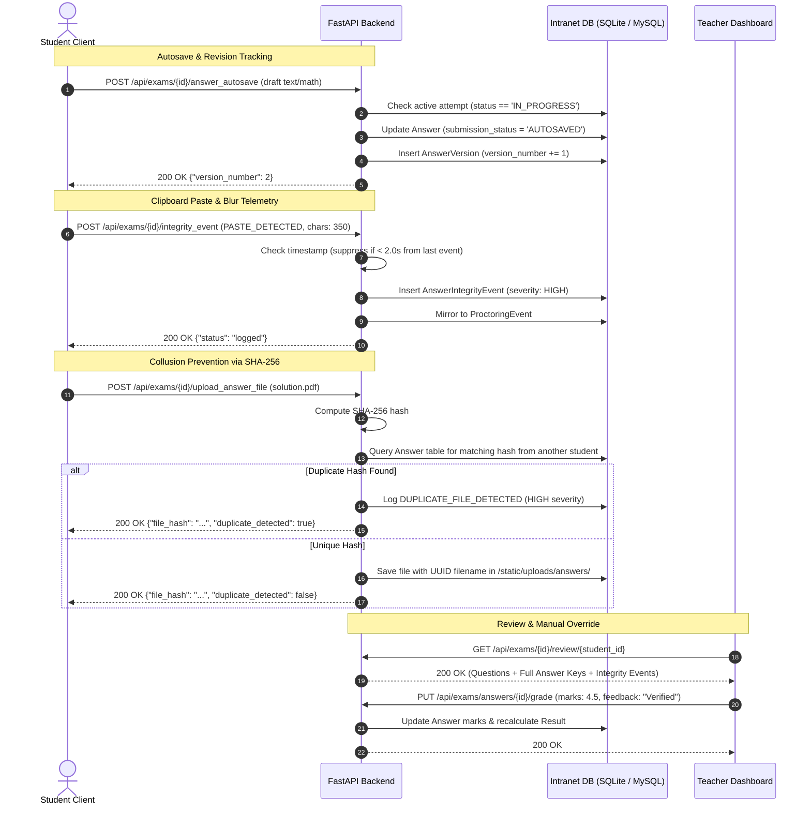

# QIS — Examination Monitoring, Answer Integrity & AI Proctoring Report

**Document ID:** `QIS-INTEGRITY-REPORT-2026-V1`
**Author:** Ujjwal Upreti (`fmy9036@gmail.com`)
**Scope:** Answer Integrity, Autosave Versioning, Collusion Detection & Proctoring
**Status:** FULLY INTEGRATED & VERIFIED

---

## 1. Executive Summary

To safeguard online assessment integrity across 1,000+ simultaneous candidates, QIS establishes a multi-layered integrity architecture combining:

1. **In-Progress Answer Autosave & Immutable Revision Versioning:** Student answers are periodically autosaved without corrupting finalized records, writing each revision into an immutable `AnswerVersion` audit log.
2. **Behavioral Integrity Tracking:** Student clipboard paste actions (`PASTE_DETECTED`), pasted character counts, browser blur (`BROWSER_BLUR`), and fullscreen exits are logged with a 2-second suppression window to avoid event flooding.
3. **Cryptographic File Hash & Cross-Student Collusion Detection:** Uploaded solution files (PDFs and diagrams) generate server-side SHA-256 hashes. If two students upload identical files in the same exam, a high-severity `DUPLICATE_FILE_DETECTED` proctoring alert is automatically dispatched.
4. **Information Leakage Prevention:** The student review API (`/api/exams/{id}/review/{student_id}`) redacts correct MCQ answer keys for student callers, completely eliminating inspection risks via browser DevTools.

---

## 2. Integrity Architecture & Data Flow

---

## 3. Database Schema Extensions

### `answer` Table (Extensions)

- `answer_type`: Format classification (`TEXT`, `MATH_EQUATION`, `AUTOMATA_GRAPH`, `TABLE`, `PDF_UPLOAD`, `IMAGE_UPLOAD`).
- `structured_answer`: Textual JSON representation of structured 5-tuples or tables.
- `file_reference`: Absolute/relative filesystem path.
- `file_hash`: SHA-256 cryptographic hex digest (64 characters).
- `version_number`: Monotonically incrementing integer.
- `submission_status`: Enum (`DRAFT`, `AUTOSAVED`, `SUBMITTED`).
- `submitted_at`, `updated_at`: UTC timestamps.

### `answer_version` Table

| Column                | Type                    | Description                                 |
| --------------------- | ----------------------- | ------------------------------------------- |
| `id`                | `INTEGER PRIMARY KEY` | Auto-increment identifier                   |
| `answer_id`         | `INTEGER`             | Foreign key referencing `answer.id`       |
| `attempt_id`        | `INTEGER`             | Foreign key referencing `exam_attempt.id` |
| `question_id`       | `INTEGER`             | Foreign key referencing `question.id`     |
| `version_number`    | `INTEGER`             | Incremental revision number                 |
| `answer_type`       | `VARCHAR(50)`         | Format type at time of save                 |
| `answer_text`       | `TEXT`                | Draft body content                          |
| `structured_answer` | `TEXT`                | JSON snapshot                               |
| `file_reference`    | `VARCHAR(500)`        | File pointer                                |
| `file_hash`         | `VARCHAR(64)`         | SHA-256 checksum                            |
| `change_summary`    | `VARCHAR(255)`        | Autosave or manual trigger description      |
| `created_at`        | `DATETIME`            | UTC timestamp                               |

### `answer_integrity_event` Table

| Column              | Type                    | Description                                                       |
| ------------------- | ----------------------- | ----------------------------------------------------------------- |
| `id`              | `INTEGER PRIMARY KEY` | Auto-increment identifier                                         |
| `attempt_id`      | `INTEGER`             | Foreign key referencing `exam_attempt.id`                       |
| `question_id`     | `INTEGER`             | Question ID where event occurred (nullable)                       |
| `event_type`      | `VARCHAR(50)`         | `PASTE_DETECTED`, `BROWSER_BLUR`, `DUPLICATE_FILE_DETECTED` |
| `character_count` | `INTEGER`             | Characters pasted (if applicable)                                 |
| `severity`        | `VARCHAR(20)`         | `LOW`, `MEDIUM`, `HIGH`                                     |
| `metadata_json`   | `TEXT`                | Telemetry payload (coordinates, window state, hash)               |
| `review_status`   | `VARCHAR(50)`         | `PENDING`, `FLAGGED`, `CLEARED`                             |
| `timestamp`       | `DATETIME`            | UTC timestamp                                                     |

---

## 4. Test Verification & Live Empirical Results

The live test suite (`backend/tests/test_answer_integrity_and_security.py`) executed against the running FastAPI server on port 5001:

| Test ID     | Test Scenario                                        | Expected Result                                                     | Actual Result                                   | Status           |
| ----------- | ---------------------------------------------------- | ------------------------------------------------------------------- | ----------------------------------------------- | ---------------- |
| `test_01` | In-progress autosave & version increment             | `version_number` increments 1 $\to$ 2, `AnswerVersion` logged | 2 revisions in DB, versions 1 and 2 verified    | **PASSED** |
| `test_02` | Paste tracking & rapid-fire suppression              | First paste logged; second within 100ms suppressed                  | `{"status": "duplicate_suppressed"}`          | **PASSED** |
| `test_03` | Browser blur event                                   | Recorded with MEDIUM severity                                       | Event persisted in `answer_integrity_event`   | **PASSED** |
| `test_04` | SHA-256 hashing & cross-student duplicate file alert | Student 1 upload OK; Student 2 duplicate upload detected            | `duplicate_detected: true`, same hash matched | **PASSED** |
| `test_05` | Student role access control on review endpoint       | Calling `/api/exams/{id}/review/{student_id}` blocked             | HTTP 403 Forbidden                              | **PASSED** |
| `test_06` | Teacher review access & answer key visibility        | Teacher receives review payload with `correct_option`             | HTTP 200 OK, `correct_option: "O(n log n)"`   | **PASSED** |
| `test_07` | Student grade override protection                    | Student cannot alter grades via `/api/exams/answers/{id}/grade`   | HTTP 403 Forbidden                              | **PASSED** |

**Summary:** 7/7 live security and integrity tests passed in 0.307s with zero failures.
