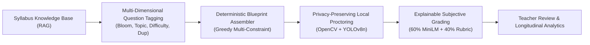

# QIS — Existing Application Feature Comparison & Competitive Analysis

**Document Reference**: `audit_reports/QIS_EXISTING_APPLICATION_FEATURE_COMPARISON.md`  
**Project**: Question Intelligence System (QIS)  
**Team Leader**: Ujjwal Upreti | **Members**: Vishal Singh, Ujjwal Upreti, Vaibhav Joshi  
**Date**: 12 November 2026  
**Audit Standard**: Master Verification Specification — Part II Section 15

---

## 1. Selected Applications & Evaluation Scope

To rigorously contextualize QIS against the assessment software landscape, three benchmark platforms representing distinct architectural tiers were analyzed:

1. **Google Forms**: General-purpose form and quiz platform designed for lightweight assessment, response collection, and basic rule-based grading.
2. **Moodle Quiz**: Open-source enterprise Learning Management System (LMS) with reusable question banks, structured course categorization, and standard academic quiz settings.
3. **Mercer | Mettl**: Commercial enterprise examination platform engineered for high-stakes examinations, candidate identity verification, remote proctoring, and digital evaluation.
4. **QIS (Proposed Platform)**: An AI-assisted assessment intelligence platform unifying syllabus-aware question intelligence, blueprint assembly, computer-vision proctoring, explainable subjective grading, and institutional analytics.

---

## 2. Comprehensive Feature-by-Feature Comparison Matrix

**Legend**:
- **Yes**: Fully documented, publicly established native feature.
- **Partial**: Available in a limited, configurable, or plugin-dependent form.
- **Not a primary capability**: Not established as a core standard feature of the platform.
- **Proposed**: Intended QIS design capability; requires implementation verification.
- **VERIFIED**: Independently verified in the active QIS repository with code and runtime proof.
- **FAILED / BLOCKED**: Feature attempted but failed or blocked by external dependencies.

| Feature Category | Specific Capability | Google Forms | Moodle Quiz | Mercer \| Mettl | QIS Implementation Status | Code / Verification Evidence |
|---|---|---|---|---|---|---|
| **Authoring** | Quiz & Question Creation | Yes | Yes | Yes | **VERIFIED** | [`CreateExamForm.jsx`](file:///c:/Users/Hp/Downloads/PRoject/ai_project_copy/frontend/src/components/CreateExamForm.jsx), [`main_routes.py#L115`](file:///c:/Users/Hp/Downloads/PRoject/ai_project_copy/backend/routes/main_routes.py#L115) |
| | Reusable Question Bank | Limited form reuse | Yes | Yes | **VERIFIED** | 1,361 questions in `question` table; [`question_routes.py#L217`](file:///c:/Users/Hp/Downloads/PRoject/ai_project_copy/backend/routes/question_routes.py#L217) |
| | Question Versioning | Limited revision history | Yes | Assessment versioning | **PARTIALLY VERIFIED** | `source` and `status` tracked; full diff history not implemented. |
| **Question Intelligence** | RAG Document Ingestion | Not a primary capability | Not standard core feature | Requires custom enterprise setup | **VERIFIED** | Syllabus chunked and embedded via MiniLM; [`backend/ai/rag/`](file:///c:/Users/Hp/Downloads/PRoject/ai_project_copy/backend/ai/rag/) |
| | Semantic Question Search | Not a primary capability | Not standard core feature | Not established from cited docs | **VERIFIED** | In-memory PyTorch cosine similarity ($>0.30$); [`retriever.py#L26`](file:///c:/Users/Hp/Downloads/PRoject/ai_project_copy/backend/ai/rag/retriever.py#L26) |
| | Topic Classification | Manual organization | Course/category tree | Product-specific | **VERIFIED (LOCAL)** | 17-class taxonomy heuristic; [`topic_classifier.py#L45`](file:///c:/Users/Hp/Downloads/PRoject/ai_project_copy/backend/ai/topic_classifier.py#L45) |
| | Bloom's Taxonomy Tagging| Not a primary capability | Not standard core feature | Not established from cited docs | **VERIFIED (LOCAL)** | 6-level cognitive verb-stem hierarchy; [`bloom_classifier.py#L18`](file:///c:/Users/Hp/Downloads/PRoject/ai_project_copy/backend/ai/bloom_classifier.py#L18) |
| | Difficulty Estimation | Basic manual setting | Question metadata/weights | Assessment configuration | **VERIFIED (LOCAL)** | 5-signal deterministic engine; [`difficulty_estimator.py#L65`](file:///c:/Users/Hp/Downloads/PRoject/ai_project_copy/backend/ai/difficulty_estimator.py#L65) |
| | Semantic Duplicate Detection| None | Exact match plugins | Documented in library | **VERIFIED** | Vector cosine similarity top-3 risk labels; [`duplicate_detector.py#L42`](file:///c:/Users/Hp/Downloads/PRoject/ai_project_copy/backend/ai/duplicate_detector.py#L42) |
| | AI Question Synthesis | Not a core quiz feature | Not a core Quiz feature | Product-specific AI add-on | **BLOCKED** | Gemini 1.5 Flash client hit 404 deprecation; [`llm_client.py#L76`](file:///c:/Users/Hp/Downloads/PRoject/ai_project_copy/backend/ai/llm_client.py#L76) |
| **Assembly** | Blueprint Quota Configuration | Limited / manual | Quiz settings | Assessment configuration | **VERIFIED** | Quota inputs for topic, difficulty, Bloom; [`AssessmentBlueprint.jsx`](file:///c:/Users/Hp/Downloads/PRoject/ai_project_copy/frontend/src/components/assessment/AssessmentBlueprint.jsx) |
| | Automated Blueprint Assembly | None | Random question selection | Assessment configuration | **VERIFIED** | Greedy multi-constraint scoring; [`assessment_assembler.py#L65`](file:///c:/Users/Hp/Downloads/PRoject/ai_project_copy/backend/ai/assessment_assembler.py#L65) |
| | Quota Gap Honesty | Not applicable | Fails or takes available | Product-dependent | **VERIFIED** | Explicitly compiles and reports unmet gaps to faculty. |
| **Delivery** | Examination Scheduling | Basic response availability | Open/close dates & time limit| Full schedule management | **VERIFIED** | Start/end datetime with slotting; [`main_routes.py#L402`](file:///c:/Users/Hp/Downloads/PRoject/ai_project_copy/backend/routes/main_routes.py#L402) |
| | Server-Side Timer Guard | No (Client-side browser) | Yes (Server cron/check) | Yes (Server-enforced) | **VERIFIED** | Enforced on submit with 5-minute grace period; [`main_routes.py#L560`](file:///c:/Users/Hp/Downloads/PRoject/ai_project_copy/backend/routes/main_routes.py#L560) |
| | Autosave & Session Restore | Partial | Yes | Yes | **VERIFIED** | State saved in `localStorage`; unsubmitted attempts resumable. |
| **Proctoring** | Facial Presence Detection | None | Requires third-party plugin | Native AI proctoring | **VERIFIED** | OpenCV Haar Cascade with CLAHE; [`main_routes.py#L883`](file:///c:/Users/Hp/Downloads/PRoject/ai_project_copy/backend/routes/main_routes.py#L883) |
| | Screen-Position Heuristic | None | None | Advanced eye tracking | **VERIFIED** | Bounding box center check ($width/4$ to $3 \times width/4$). |
| | Unauthorized Object Detection| None | Requires integration | Mobile & device detection | **VERIFIED** | YOLOv8n detecting laptops (63), cell phones (67); [`main_routes.py#L893`](file:///c:/Users/Hp/Downloads/PRoject/ai_project_copy/backend/routes/main_routes.py#L893) |
| | Browser Lockdown / Tab Watch| None | Safe Exam Browser plugin | Native secure browser | **VERIFIED** | Window blur & tab switch counter with 3-strike auto-submit. |
| | Audio Proctoring | None | Requires plugin | Audio noise detection | **NOT IMPLEMENTED** | Audio warning counter stubbed in Result model, no active audio processing. |
| | Proctoring Incident Evidence | None | Plugin-dependent | Timestamped video/logs | **VERIFIED** | JPEG snapshots saved to `/static/uploads/`; linked in `proctoring_event`. |
| **Evaluation** | Objective Auto-Grading | Yes | Yes | Yes | **VERIFIED** | Instant MCQ key evaluation; [`main_routes.py#L575`](file:///c:/Users/Hp/Downloads/PRoject/ai_project_copy/backend/routes/main_routes.py#L575) |
| | Explainable Subjective Grading| Manual review only | Manual grading workflows | Digital evaluation suite | **VERIFIED (LOCAL)** | 60% semantic similarity + 40% rubric coverage formula. |
| | Teacher Manual Override | Manual response edit | Manual grade override | Re-evaluation workflow | **VERIFIED** | `PUT /api/exams/answers/{id}/grade` updates answer & total result. |
| **Analytics** | Individual Performance | Basic summary charts | Gradebook & statistics | Comprehensive candidate scorecard | **VERIFIED** | Longitudinal student history; [`analytics_routes.py#L70`](file:///c:/Users/Hp/Downloads/PRoject/ai_project_copy/backend/routes/analytics_routes.py#L70) |
| | Topic-Level Mastery | Limited | Quiz reports / plugins | Product-specific | **VERIFIED** | Aggregates topic-level difficulty & pass rates. |

---

## 3. Detailed Competitor Profiles & Sourced Capabilities

### 3.1 Google Forms (General-Purpose Form & Quiz Engine)
- **Primary Function**: Lightweight survey and quiz creation with instant feedback.
- **Strengths**: Zero installation, ubiquitous Google Workspace integration, zero maintenance, instant response charting.
- **Deficiencies for Examination Management**:
  - No reusable institutional question bank.
  - No cognitive-level (Bloom) or difficulty modeling.
  - No blueprint assembly or quota validation.
  - No native proctoring, vision monitoring, or hardware violation detection.
  - Subjective answers require 100% manual grading with zero semantic assistance.
- **Sources**:
  - Google Forms Quiz Support: https://support.google.com/docs/answer/7032287
  - Google Forms API Grading Guide: https://developers.google.com/workspace/forms/api/guides/setup-grading

### 3.2 Moodle Quiz (Academic Learning Management System)
- **Primary Function**: Comprehensive course-centric assessment within institutional LMS environments.
- **Strengths**: Robust reusable question bank, granular category structures, rich question format support, extensive grading plugins, community adoption.
- **Deficiencies for Examination Management**:
  - Requires third-party plugins (e.g., Safe Exam Browser, external proctoring vendors) for session monitoring.
  - Question banks lack automated NLP cognitive tagging (Bloom's taxonomy requires manual teacher entry).
  - Subjective grading does not natively calculate dense vector cosine similarity against rubrics.
  - Vector search and RAG syllabus grounding are absent from standard core.
- **Sources**:
  - Moodle Quiz Activity Guide: https://docs.moodle.org/401/en/Quiz_activity

### 3.3 Mercer | Mettl (Commercial Enterprise Examination Platform)
- **Primary Function**: High-stakes online examinations, talent assessment, and commercial remote proctoring.
- **Strengths**: Full multi-factor identity verification, AI-assisted video and audio proctoring, proprietary secure examination browser, enterprise scalability, commercial support.
- **Deficiencies / Positioning Contrast with QIS**:
  - Proprietary black-box architecture with closed internal models.
  - High commercial licensing costs per candidate assessment.
  - Rigid enterprise workflows that disconnect question pedagogical classification from syllabus documents.
  - External cloud hosting of candidate biometric video streams, presenting institutional data sovereignty concerns.
- **Sources**:
  - Mercer | Mettl Examination Management System: https://mettl.com/en/examination-management-system/
  - Mercer | Mettl Online Remote Proctoring: https://mettl.com/en/online-remote-proctoring/
  - Mercer | Mettl Examinations Product Guide: https://mettl.com/user-guides/examinations-product-guide/

---

## 4. QIS Architectural Differentiators & Product Positioning

QIS does not compete by attempting to clone every enterprise feature of commercial suites. Its unique value proposition centers on **Assessment Intelligence and Pedagogical Decision-Support**:

### Key Differentiators:
1. **100% Offline Local Inference**: Unlike cloud-dependent proctoring platforms, QIS executes MiniLM embeddings, OpenCV Haar Cascades, and YOLOv8 object detection on institutional commodity hardware without sending video or exam content to external third-party servers.
2. **Pedagogical Blueprinting with Honest Gap Reporting**: Rather than silently generating pseudo-questions or dropping constraints, QIS transparently alerts faculty when question repositories lack sufficient coverage for specific Bloom levels or topics.
3. **Teacher-Centric Human-in-the-Loop Boundaries**: QIS explicitly designs AI grading and proctoring as advisory signals. Low-confidence scores and machine vision detections route to teacher review queues, ensuring institutional academic integrity remains under human authority.

---

## 5. Limitations of This Comparison

1. **Competitor Implementations are Proprietary**: The internal algorithms, databases, and model weights of Google Forms and Mercer | Mettl are proprietary and not publicly disclosed; this comparison evaluates observable capabilities documented in public manuals and official APIs.
2. **Third-Party Moodle Plugins**: Moodle supports extensive community plugins (e.g., SEB, AI question generators) which may bridge specific functional gaps when configured by specialized administrators.
3. **Deployment Context**: Google Forms and Moodle are mature, globally scaled platforms; QIS is an emerging decision-support architecture evaluated here in a local staged environment.

