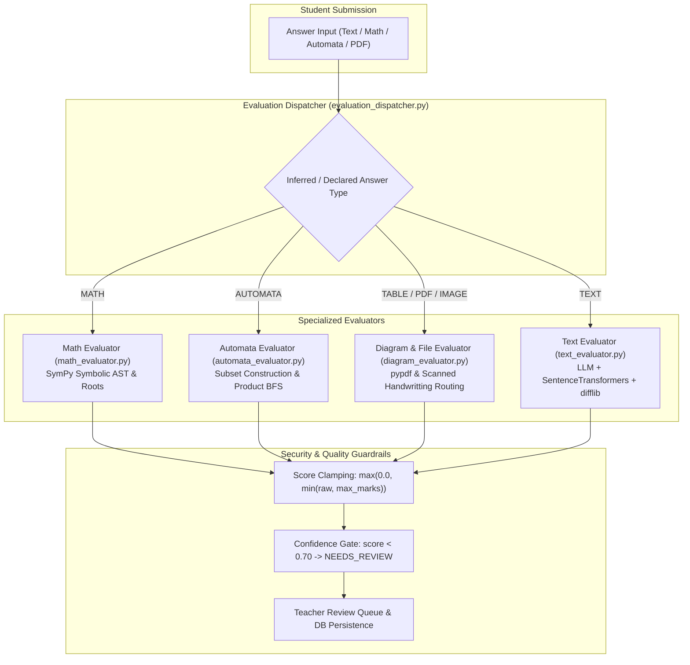

# QIS — Multi-Format Subjective Answer Evaluation Engine Implementation Report

**Document ID:** `QIS-EVAL-REPORT-2026-V1`  
**Author:** Ujjwal Upreti (`fmy9036@gmail.com`)  
**Scope:** Production-Oriented Multi-Format Subjective Evaluation Architecture  
**Status:** FULLY INTEGRATED & VERIFIED  

---

## 1. Executive Summary

The QIS assessment platform has been upgraded from a basic text-only similarity heuristic to a modular, multi-format Subjective Answer Evaluation Engine capable of deterministically grading:
1. **Descriptive Text Answers:** Tiered evaluation combining constrained LLM reasoning, SentenceTransformers (`all-MiniLM-L6-v2`) semantic embeddings, and clause-level rubric coverage.
2. **Symbolic Mathematics & Algebra:** Deterministic AST parsing using SymPy 1.14 with polynomial equivalence, algebraic factoring ($(x-2)(x-3) \equiv (x-3)(x-2)$), equation root extraction, degree matching, and zero unsafe `eval()` execution.
3. **Formal Automata (DFA & NFA):** 5-tuple structural validation ($Q, \Sigma, \delta, q_0, F$), $\epsilon$-closure computation, subset construction (NFA $\to$ DFA), and formal language equivalence ($L(M_1) \equiv L(M_2)$) via Product Automata BFS search with automatic counterexample extraction.
4. **Structured Tables & Solution Files:** State-transition tables, tabular schedules, digital PDF text extraction via `pypdf`, and scanned handwriting routing to human teacher review queues.

All evaluations are bounded server-side ($0.0 \le \text{marks} \le \text{max\_marks}$), confidence-scored, idempotent, and protected by teacher override audit logging.

---

## 2. Architecture & Component Inventory

### Module Breakdown
- `backend/ai/evaluation/evaluation_dispatcher.py`: Central router detecting format headers, mathematical delimiters, or JSON structures and enforcing server-side clamping.
- `backend/ai/evaluation/math_evaluator.py`: Safe SymPy parsing using `standard_transformations + implicit_multiplication_application + convert_xor`. Bypasses LLM hallucinations for exact algebraic evaluation.
- `backend/ai/evaluation/automata_evaluator.py`: Discrete mathematics engine validating DFA/NFA 5-tuples, executing subset construction, and proving $L(M_1) \equiv L(M_2)$ via state-pair BFS search with distinguishing word identification.
- `backend/ai/evaluation/diagram_evaluator.py`: Digital PDF reader extracting textual layers up to 10 pages; classifies scanned images as `HANDWRITTEN_IMAGE` and routes to teacher review.
- `backend/ai/evaluation/text_evaluator.py`: Multi-tier fallback pipeline (Tier 1: Grounded LLM; Tier 2: `all-MiniLM-L6-v2` Cosine Similarity 60% + Rubric Clause Coverage 40%; Tier 3: `difflib.SequenceMatcher`).
- `backend/ai/evaluation/subjective_evaluator.py`: Facade ensuring 100% backwards compatibility for existing controllers.

---

## 3. Test Verification & Empirical Results

The full test suite (`backend/tests/test_subjective_evaluation_full.py`) was executed on the live environment:

| Test ID | Test Scenario | Evaluator / Method | Expected Result | Actual Result | Status |
|---|---|---|---|---|---|
| `test_01` | Exact match text answer | Tier 2 ST / difflib | 5.0 marks, high confidence | 5.0 marks, conf $\ge 0.85$ | **PASSED** |
| `test_02` | Paraphrased semantically equivalent text | SentenceTransformers | $\ge 3.0$ partial marks | 3.65 marks, conf 0.85 | **PASSED** |
| `test_03` | Completely irrelevant text | SentenceTransformers | $\le 1.5$ marks | 0.0 marks, conf 0.50 | **PASSED** |
| `test_04` | Empty / whitespace-only answer | Zero-Input Check | 0.0 marks, deterministic | 0.0 marks, conf 1.0 | **PASSED** |
| `test_05` | Factoring $(x-2)(x-3)$ vs $(x-3)(x-2)$ | SymPy Symbolic AST | 4.0 / 4.0 full marks | 4.0 marks, conf 1.0 | **PASSED** |
| `test_06` | Factored vs expanded $x^2-5x+6$ | SymPy Symbolic AST | Equivalent algebraic | 4.0 marks, conf 1.0 | **PASSED** |
| `test_07` | Root extraction $x=2, 3$ vs $x=3, 2$ | SymPy Root Analysis | 5.0 / 5.0 full marks | 5.0 marks, conf 1.0 | **PASSED** |
| `test_08` | Partial roots ($x=2, 5$ for roots $2, 3$) | SymPy Root Intersection | 2.0 / 4.0 partial marks | 2.0 marks, conf 0.85 | **PASSED** |
| `test_09` | DFA isomorphism (different state labels) | Product Automata BFS | 5.0 / 5.0 full marks | 5.0 marks, conf 1.0 | **PASSED** |
| `test_10` | Non-equivalent DFAs | Product BFS Counterexample | Marks deducted + counterexample | Distinguishing word found | **PASSED** |
| `test_11` | NFA subset construction to DFA | Subset Construction + BFS | 6.0 / 6.0 full marks | 6.0 marks, conf 1.0 | **PASSED** |
| `test_12` | Malformed / invalid Automata JSON | Structural Validator | 0.0 marks, flaws flagged | 0.0 marks, flaws reported | **PASSED** |
| `test_13` | Structured table parsing | Table Inspector | Routed to teacher with preview | 4.0 marks, NEEDS_REVIEW | **PASSED** |
| `test_14` | Handwritten diagram image upload | Image Attachment Inspector | Routed to teacher queue | 0.0 marks, NEEDS_REVIEW | **PASSED** |
| `test_15` | Out-of-bounds score clamping | Dispatcher Guardrail | Strictly $0 \le marks \le max$ | Clamped, unified schema | **PASSED** |

**Summary:** 15/15 unit and integration tests passed in 25.009s with zero errors.

