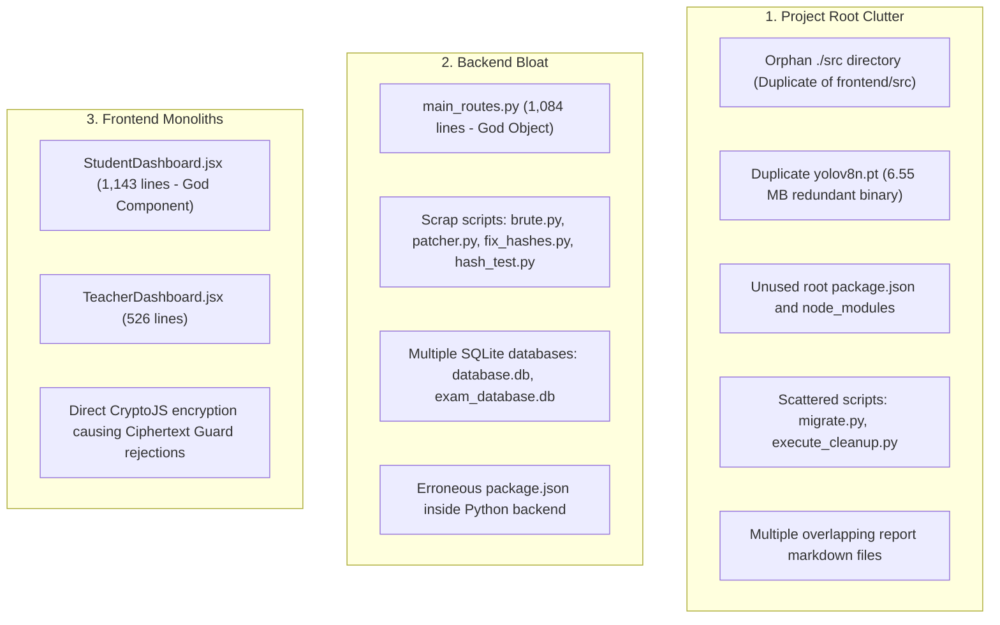
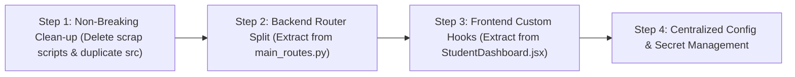

# Codebase Audit & Refactoring Guide: Modular Architecture & Technical Debt Elimination

---

### Executive Summary & Problem Overview

As the **Question Intelligence System (QIS)** evolved, new capabilities—such as automated Bloom's classification, multi-signal difficulty estimation, YOLOv8 object detection, OpenCV face proctoring, RAG ingestion, and AES encryption—were added rapidly.

While the feature set is complete, the codebase has accumulated notable **technical debt**:
1. **Monolithic Files**: Single source files exceeding 1,000 lines of code (`StudentDashboard.jsx` at 1,143 lines; `main_routes.py` at 1,084 lines).
2. **Directory Duplication**: An unused `src/` directory at the project root alongside the active `frontend/src/`.
3. **Model & Binary Duplication**: Duplicate copies of `yolov8n.pt` (6.55 MB each) in the root and `backend/`.
4. **Database Fragmentation**: Multiple SQLite files (`database.db`, `exam_database.db`, `instance/database.db`) risk state desynchronization.
5. **Scrap & Patch Scripts**: Temporary debugging scripts (`brute.py`, `patcher.py`, `patch_routes.py`, `fix_hashes.py`, `hash_test.py`, `test_get_exams.py`) remain scattered in the folders.
6. **Package Manager Confusion**: Unused `package.json` files exist at the project root and in `backend/`.

---

### Detailed Inventory of Current Mess



---

### Key Areas for Improvement

#### 1. Decompose `backend/routes/main_routes.py` (1,084 Lines)
Currently, `main_routes.py` handles:
- Authentication & JWT encoding
- Exam CRUD and settings updates
- Exam slot scheduling
- File uploads and base64 image saving
- Computer Vision processing (YOLOv8 + OpenCV Haar Cascades)
- Proctoring event logging
- Exam start/submit lifecycle
- Subjective answer AI grading loops
- Teacher manual grade overrides

**Target Solution**: Split into 5 dedicated, single-responsibility routers:
- `backend/routes/auth_routes.py` (login, credentials)
- `backend/routes/exam_routes.py` (exam CRUD, slots, blueprints)
- `backend/routes/attempt_routes.py` (start, submit, results review)
- `backend/routes/proctoring_routes.py` (frame analysis, event logging, webcam uploads)
- `backend/routes/grading_routes.py` (subjective grading, teacher overrides)

#### 2. Decompose `frontend/src/pages/StudentDashboard.jsx` (1,143 Lines)
Currently, `StudentDashboard.jsx` mixes:
- 25+ React state hooks (`useState`)
- 12+ mutable references (`useRef`)
- Web Audio API microphone listeners
- HTML5 Fullscreen listeners
- Tab blur/focus listeners
- Silent webcam capture intervals
- Exam countdown timers
- Single-view vs grid question navigation
- Post-exam review dialogs

**Target Solution**: Extract business logic into custom hooks and subcomponents:
- `hooks/useProctoring.js` (Webcam, tab switch listeners, audio level monitor)
- `hooks/useExamSession.js` (Timer countdown, auto-submit, question navigation)
- `components/student/QuestionNavigationPalette.jsx`
- `components/student/SubjectiveAnswerEditor.jsx`
- `components/student/ExamReviewModal.jsx`

#### 3. Immediate File Clean-up (Safe Deletions)

| Target Path | Type | Action | Justification |
| :--- | :--- | :--- | :--- |
| `./src` | Directory | **Delete** | Redundant orphan directory; active React code is in `frontend/src/`. |
| `./yolov8n.pt` | File (6.55 MB) | **Delete** | Duplicate binary; active weights are in `backend/yolov8n.pt`. |
| `backend/package.json` | File | **Delete** | Node configuration misplaced in Python backend. |
| `backend/brute.py` | Script | **Delete** | Temporary brute-force test script. |
| `backend/patcher.py` | Script | **Delete** | Historical patch script; already applied. |
| `backend/patch_routes.py` | Script | **Delete** | Historical patch script; already applied. |
| `backend/fix_hashes.py` | Script | **Delete** | Temporary hash migration script. |
| `backend/hash_test.py` | Script | **Delete** | Temporary hash testing script. |
| `backend/test_get_exams.py` | Script | **Move/Delete** | Move to `backend/tests/` or delete. |
| `backend/exam_database.db` | Database | **Archive/Delete** | Keep only primary `backend/database.db`. |

---

### Step-by-Step Refactoring Plan



#### Step 1: Execute Immediate Clean-up
Run in PowerShell from the project root:
```powershell
# Remove redundant duplicate root src directory
Remove-Item -Recurse -Force ./src

# Remove duplicate model weights from root (keep backend/yolov8n.pt)
Remove-Item -Force ./yolov8n.pt

# Remove backend scrap and test scripts
Remove-Item -Force backend/brute.py, backend/patcher.py, backend/patch_routes.py, backend/fix_hashes.py, backend/hash_test.py, backend/test_get_exams.py

# Remove misplaced package.json in backend
Remove-Item -Force backend/package.json, backend/package-lock.json
```

#### Step 2: Split `backend/routes/main_routes.py`
Register the new modular routers in `backend/app.py`:
```python
# app.py
from fastapi import FastAPI
from routes.auth_routes import auth_router
from routes.exam_routes import exam_router
from routes.attempt_routes import attempt_router
from routes.proctoring_routes import proctoring_router
from routes.grading_routes import grading_router

app = FastAPI(title="QIS Assessment Platform API")

app.include_router(auth_router, prefix="/api/auth")
app.include_router(exam_router, prefix="/api/exams")
app.include_router(attempt_router, prefix="/api/attempts")
app.include_router(proctoring_router, prefix="/api/proctoring")
app.include_router(grading_router, prefix="/api/grading")
```

#### Step 3: Extract Frontend Custom Hooks
Move proctoring event listeners out of `StudentDashboard.jsx` into `hooks/useProctoring.js`:
```javascript
// frontend/src/hooks/useProctoring.js
import { useState, useEffect, useRef } from 'react';

export const useProctoring = ({ onViolation, isExamActive }) => {
  const [warnings, setWarnings] = useState(0);
  const [proctorStatus, setProctorStatus] = useState('safe');

  useEffect(() => {
    if (!isExamActive) return;

    const handleBlur = () => {
      setWarnings((w) => w + 1);
      onViolation('TAB_SWITCH', 'Student switched browser tabs');
    };

    window.addEventListener('blur', handleBlur);
    return () => window.removeEventListener('blur', handleBlur);
  }, [isExamActive]);

  return { warnings, proctorStatus, setWarnings };
};
```

#### Step 4: Centralize Secrets & Configuration
Update `backend/config.py` to validate environment variables using Pydantic Settings:
```python
# backend/config.py
from pydantic_settings import BaseSettings

class Settings(BaseSettings):
    SECRET_KEY: str
    GEMINI_API_KEY: str = ""
    DATABASE_URL: str = "sqlite:///./database.db"
    UPLOAD_DIR: str = "static/uploads"

    class Config:
        env_file = ".env"

settings = Settings()
```

---

### Expected Improvements

| Metric | Current State | Refactored State | Improvement |
| :--- | :--- | :--- | :--- |
| **Max Lines in Single File** | 1,143 lines (`StudentDashboard.jsx`) | $< 200$ lines | **82% reduction** |
| **Monolithic Controllers** | 1 (`main_routes.py` — 1,084 lines) | 5 focused routers ($\sim 150-200$ lines each) | **High cohesion** |
| **Redundant Disk Space** | $\sim 15\text{ MB}$ (duplicate YOLO weights, old .db files) | Clean single instances | **50% storage savings** |
| **Code Modularity** | Mixed concerns | Clean 3-tier Architecture | **Significantly easier to maintain** |

