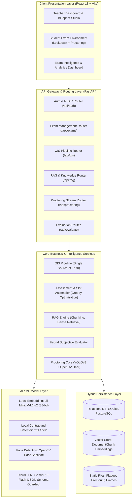
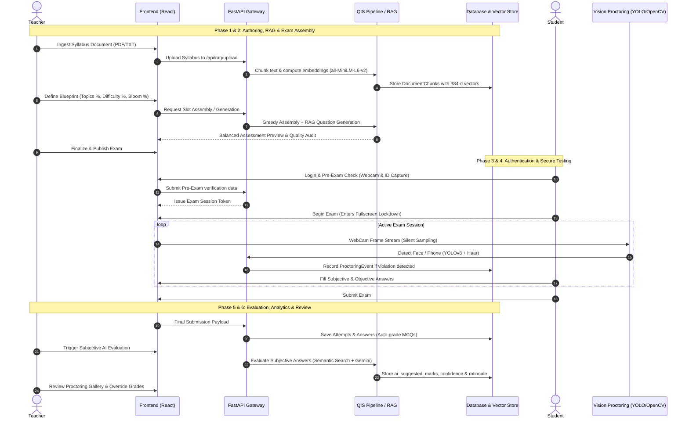
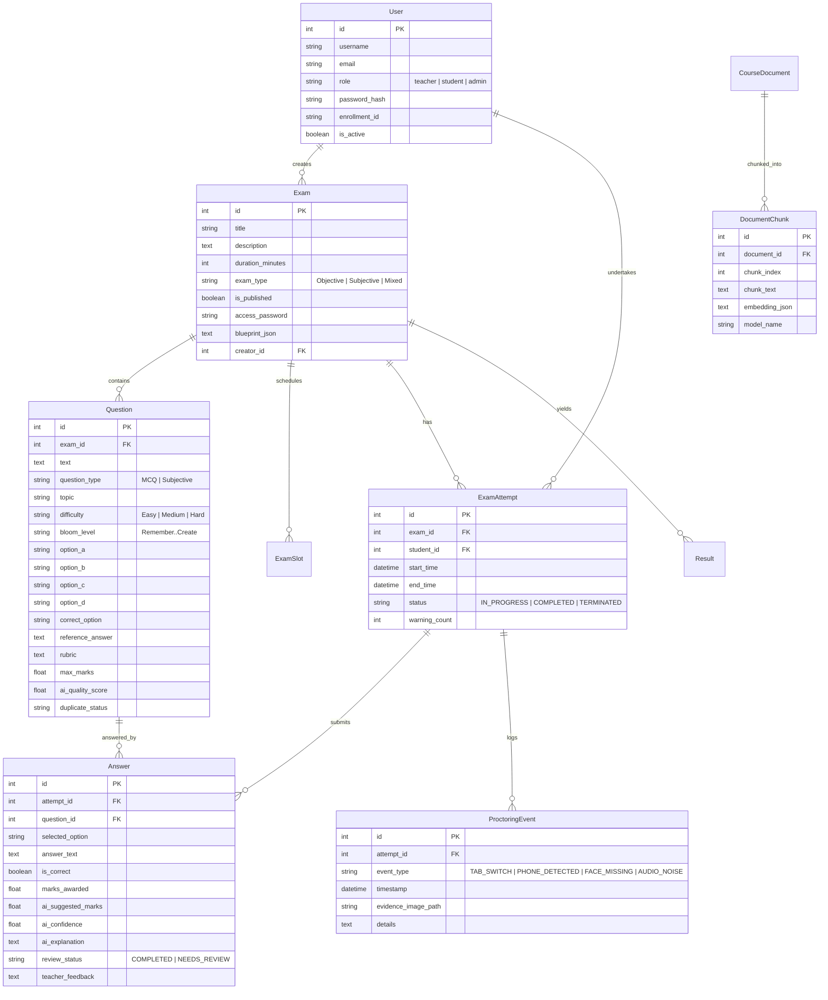

# Project Report: AI-Powered Intelligent Assessment & Proctoring System (QIS)
## File 1: System Overview, End-to-End Working, and Technical Architecture

---

### 1. Executive Summary & Project Description

The **Question Intelligence System (QIS) and Assessment Platform** is an enterprise-grade academic evaluation environment that bridges modern generative artificial intelligence, local semantic search, computer vision, and cognitive pedagogical frameworks (Bloom’s Revised Taxonomy).

#### Core Problem Addressed
Traditional examination platforms suffer from critical structural weaknesses:
1. **Manual Assessment Authoring**: Educators spend hours crafting questions, balancing difficulty, and ensuring syllabus coverage, often resulting in repetitive, rote-memory questions.
2. **Cognitive Imbalance**: Exams frequently skew toward surface recall ("Remember") rather than analytical or evaluation skills ("Analyze", "Evaluate"), failing outcome-based education (OBE) goals.
3. **Descriptive / Subjective Grading Bottlenecks**: Grading long-form and short-form answers manually leads to delays, fatigue-driven scoring variances, and lack of actionable rubric-based feedback.
4. **Academic Dishonesty in Remote Testing**: Remote and unmonitored exams face integrity risks, including unauthorized tab switching, device usage, and proxy test-taking.
5. **Fixed, Static Difficulty**: Lack of real-time item response analysis prevents institutions from verifying whether a question labeled "Hard" was genuinely challenging for students.

#### Solution Overview
This platform solves these challenges through:
- **Automated Blueprint Balancing**: Automatically enforces multi-dimensional distribution constraints across Syllabus Topics, Difficulty Percentages (Easy/Medium/Hard), and Bloom’s Taxonomy levels.
- **RAG-Grounded Question Authoring**: Knowledge base ingestion enables syllabus-constrained question generation with verifiable citations.
- **Hybrid Subjective Grading**: Pairs small local semantic embedding models (`all-MiniLM-L6-v2`) with cloud LLM evaluation, providing explainable scoring with human-in-the-loop teacher override.
- **Edge-Assisted Dual-Layer Proctoring**: Real-time webcam analysis via OpenCV (facial presence/movement) and Ultralytics YOLOv8 (electronic contraband detection) coupled with browser lockdown.
- **Item Response Empirical Calibration**: Recalibrates predicted question difficulty against live student attempt metrics.

---

### 2. High-Level System Architecture

The application adopts a decoupled, multi-tier micro-modular architecture consisting of a React-based single-page application (SPA), a high-concurrency FastAPI backend gateway, a modular AI/ML pipeline, and a hybrid vector-relational persistence layer.

---

### 3. End-to-End System Working & Lifecycle

The examination lifecycle is divided into six distinct operational phases:

#### Detailed Breakdown of Each Phase

#### Phase 1: Knowledge Base Ingestion (RAG Pre-processing)
1. **Document Upload**: The instructor uploads course reference material (PDF, TXT, DOCX).
2. **Text Normalization & Chunking**: `backend/ai/rag/document_processor.py` strips extraneous control characters and partitions the syllabus into contiguous sliding chunks of ~500 characters with 100-character overlap.
3. **Dense Vector Generation**: Each chunk is embedded via the local `sentence-transformers/all-MiniLM-L6-v2` model into a 384-dimensional floating-point array.
4. **Relational Vector Storage**: The embedding is serialized and persisted into the `DocumentChunk` SQL table, indexed by `document_id`.

#### Phase 2: Blueprint Definition & Intelligent Exam Assembly
1. **Blueprint Configuration**: The teacher specifies target distributions:
   - **Topics**: e.g., Data Structures (40%), Algorithms (40%), Database Systems (20%).
   - **Difficulty Profile**: e.g., Easy (30%), Medium (50%), Hard (20%).
   - **Bloom's Cognitive Distribution**: e.g., Remember (20%), Understand (30%), Apply (30%), Analyze (15%), Evaluate (5%).
2. **Greedy Assessment Assembler**: `backend/ai/assessment_assembler.py` calculates integer quotas for each stratum. It iterates through the active `Question` bank, computing a fitness score for each item:
   $$\text{Score} = w_{\text{topic}} \cdot \mathbb{I}_{\text{topic}} + w_{\text{diff}} \cdot \mathbb{I}_{\text{diff}} + w_{\text{bloom}} \cdot \mathbb{I}_{\text{bloom}} + w_{\text{qual}} \cdot Q_{\text{score}} - w_{\text{dup}} \cdot D_{\text{risk}}$$
3. **Gap Resolution via RAG Generation**: If the question bank lacks sufficient items matching specific criteria (e.g., Hard + Analyze in Database Systems), `backend/ai/question_generator.py` retrieves relevant context chunks via cosine similarity and prompts the LLM to generate candidate questions strictly grounded in syllabus text.
4. **Slot Division**: When multiple examination slots (variants) are needed for staggered schedules, `backend/ai/slot_divider.py` partitions items such that all sets preserve identical mean quality, equalized difficulty percentages, and matched topic coverage.

#### Phase 3: Student Pre-Exam Authentication & Verification
1. **Multi-Factor Pre-Check**: The student undergoes a hardware test (microphone and camera permissions), captures a live facial baseline, and uploads an institutional student ID.
2. **Password Verification**: The student enters the exam session key, which is verified server-side.
3. **Session Minting**: An `ExamAttempt` row is instantiated with a status of `IN_PROGRESS`, locking the attempt to the student's user ID and active timestamp.

#### Phase 4: Proctored Exam Execution & Anti-Cheating Engine
1. **Client Lockdown**:
   - The browser enters HTML5 Fullscreen mode (`requestFullscreen`).
   - Blur/focus event listeners intercept unauthorized tab switching or application switching (`window.onblur`).
   - System clipboard interception disables copy, cut, paste, and text selection.
2. **Vision-Based Proctoring**:
   - The webcam stream samples periodic frames and sends them to `/api/proctoring/analyze-frame`.
   - **Face Presence Tracking**: OpenCV’s Haar Cascade classifier determines face presence. Absences lasting $>5$ seconds trigger a `FACE_MISSING` incident. Multiple faces trigger a `MULTIPLE_FACES` incident.
   - **Contraband Detection**: Ultralytics YOLOv8n evaluates frames for prohibited items (cell phones, laptops, tablets) with bounding box confidence $>0.50$.
3. **Audio Monitoring**: Web Audio API monitors ambient room volume using an `AudioContext` root-mean-square (RMS) detector, flagging sustained speaking or whispers.
4. **Non-Punitive Warning System**: Violations increment a client-side warning counter (up to 3 warnings). Once reached, an automatic submission is enforced. Every infraction captures a base64 image saved to `static/uploads/` and logs a permanent `ProctoringEvent` record for post-exam review.

#### Phase 5: Automated & Hybrid Evaluation
1. **Objective Evaluation**: MCQ questions are scored instantaneously via deterministic equality checks between student selection and the canonical `correct_option`.
2. **Subjective Evaluation Pipeline**: For descriptive answers:
   - The answer is evaluated via the hybrid AI evaluator (`ai/subjective_evaluator.py`).
   - If Cloud LLM is enabled, Gemini compares the student answer against the reference answer and rubric constraints, outputting suggested marks, conceptual reasoning, and a confidence score ($0.0 - 1.0$).
   - If confidence is $\ge 0.70$, `review_status` is marked `COMPLETED`.
   - If confidence is $< 0.70$ or ambiguity exists, `review_status` is marked `NEEDS_REVIEW` and flagged on the teacher dashboard.
   - If the LLM is offline, a local semantic embedding fallback computes vector similarity and marks alignment, ensuring zero downtime.

#### Phase 6: Analytics, Calibration & Teacher Override
1. **Teacher Audit**: The teacher inspects flagged questions, overrides suggested grades, and views proctoring snapshots.
2. **Item Calibration**: `analytics_routes.py` computes the empirical difficulty of each question based on actual student performance:
   $$D_{\text{empirical}} = \left( \frac{\text{Correct Submissions}}{\text{Total Submissions}} \right) \times 100$$
   This highlights calibration mismatches (e.g., questions predicted as "Easy" that $<30\%$ of students answered correctly).

---

### 4. Database Schema & Data Models

The persistence layer uses SQLAlchemy ORM mapping over a relational database.

---

### 5. Architectural Quality Attributes & Non-Functional Guarantees

| Quality Attribute | Architectural Strategy | Code Implementation |
| :--- | :--- | :--- |
| **Fault Tolerance & Resilience** | Graceful degradation of AI modules. If Gemini API fails or times out (30s watchdog), the system falls back to local SentenceTransformers and heuristic classifiers. | `ai/llm_client.py`, `ai/subjective_evaluator.py`, `ai/bloom_classifier.py` |
| **Low Latency Proctoring** | Image inference is conducted asynchronously on sampled frames; lightweight models (`yolov8n.pt`, Haar cascades) process frames in $<60\text{ ms}$. | `backend/routes/main_routes.py` (`analyze_frame`) |
| **Deterministic Consistency** | Strict JSON schema parsing with regex boundary extraction prevents malformed LLM outputs from crashing backend handlers. | `ai/llm_client.py` (`generate_json`) |
| **Security & Privacy** | AES encryption on question transmission, zero plain-text storage of passwords (salted hashing), and role-based access control (RBAC) across all endpoints. | `auth_middleware.py`, `utils/encryption.js` |
| **Human-in-the-Loop** | AI recommendations and subjective evaluations are suggestions; teachers retain 100% override authority over final marks and proctoring penalties. | `routes/main_routes.py` (`override_grade`) |

---
*Next Document: `docs/02_ai_integration_and_mechanisms.md` for AI Architecture, RAG, and Minimal AI Semantic Search.*

