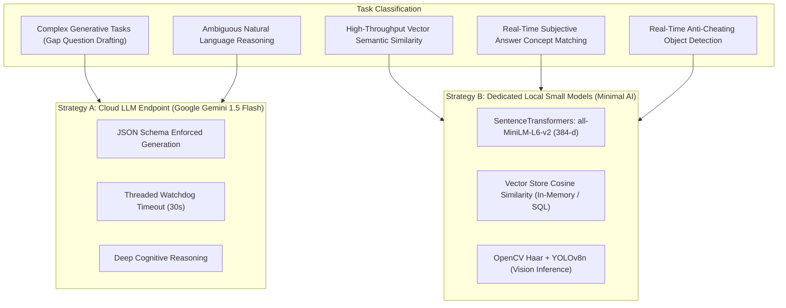
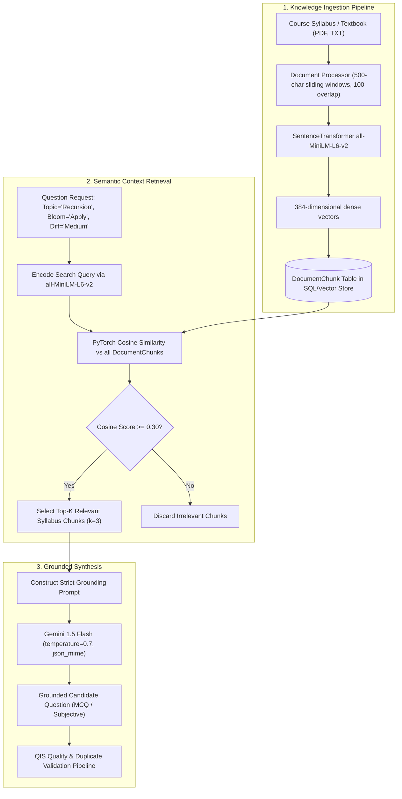
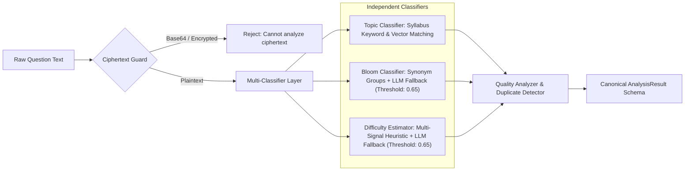
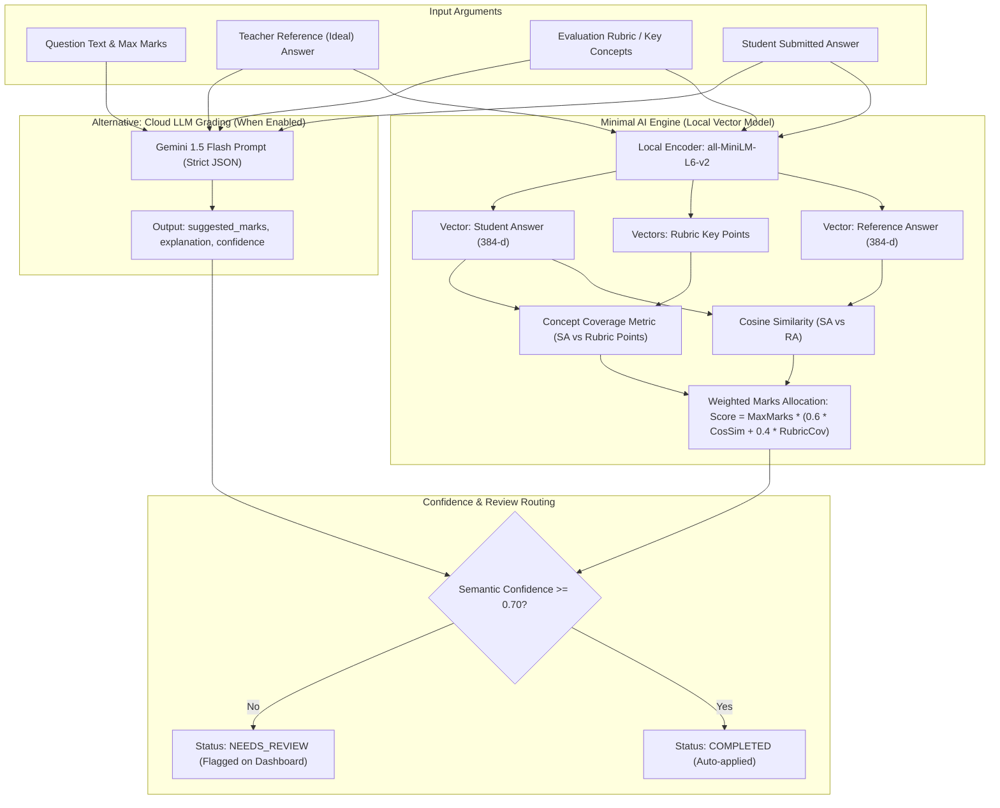
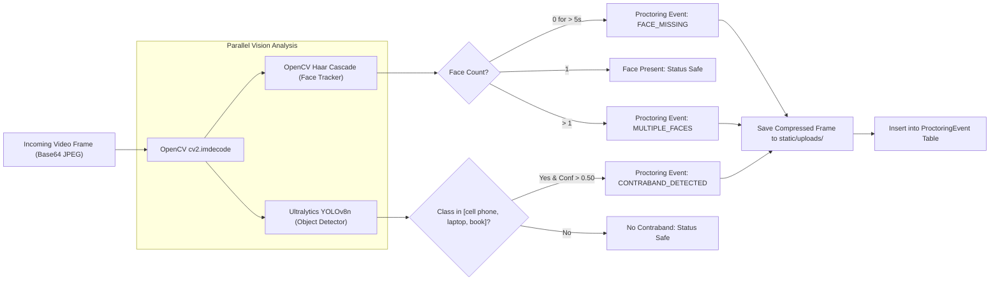

# Project Report: AI-Powered Intelligent Assessment & Proctoring System (QIS)
## File 2: AI Integration, RAG Architectures, and Minimal-AI Subjective Evaluation

---

### 1. Dual AI Integration Paradigm: Cloud LLM vs Small Dedicated Model

A core architectural strength of this platform is its **hybrid dual-layer AI strategy**. Rather than blindly funneling every task through expensive, high-latency cloud LLMs, the platform separates tasks according to complexity, latency, privacy, and cost constraints:



#### Comparison Matrix: Cloud LLM vs Dedicated Small Model

| Feature / Metric | Cloud LLM (Gemini 1.5 Flash) | Dedicated Small Model (`all-MiniLM-L6-v2` / YOLOv8n) |
| :--- | :--- | :--- |
| **Model Size** | Billion-parameter scale (Hosted) | 22.7 Million parameters (Local lightweight footprint) |
| **Hosting & Execution** | Cloud API (HTTPS REST endpoint) | 100% On-Premise / Local CPU / Local GPU |
| **Latency per Call** | 800 ms – 3,500 ms (Network + Generation) | 5 ms – 25 ms (Near-instantaneous matrix multiplication) |
| **Financial Cost** | Variable token billing per generation | $0.00 (Zero marginal operational cost) |
| **Network Dependency** | Active Internet connection required | Fully functional in offline / intranet environments |
| **Best Used For** | Synthetic question generation, complex reasoning | Semantic search, deduplication, concept matching, grading |

---

### 2. Question Generation via Retrieval-Augmented Generation (RAG)

To prevent LLM hallucination and out-of-syllabus questions, the platform implements a modular **RAG pipeline** (`backend/ai/rag/`).



#### Grounded Question Generation Prompt Design
When `use_rag=True`, context extracted from the vector store is injected into the system prompt to anchor the generative model:

```python
# From backend/ai/question_generator.py
context_instruction = f"""
--- KNOWLEDGE BASE CONTEXT ---
You must base your question ONLY on the information provided in the context below. 
Use the terminology, concepts, and facts strictly from this context.

Context:
{rag_context}
------------------------------
"""

prompt = f"""
Generate an exam question matching the following criteria:
Topic: {topic}
Bloom's Level: {bloom_level}
Difficulty: {difficulty}

{context_instruction}

Return ONLY a JSON object with this schema:
{{
    "text": "The question text",
    "option_a": "Option A text",
    "option_b": "Option B text",
    "option_c": "Option C text",
    "option_d": "Option D text",
    "correct_option": "A, B, C, or D",
    "explanation": "Why this is correct"
}}
"""
```

---

### 3. Setting Difficulty (%), Bloom Filters, and Topic Selection

The Question Intelligence System (QIS) orchestrates these dimensions using a tiered classification and validation pipeline.



#### A. Bloom's Taxonomy Classification (`ai/bloom_classifier.py`)
- **Primary Method (Deterministic)**: Evaluates action verbs and syntactic patterns against curated synonym groups across all 6 levels:
  - *Create*: design, construct, develop, formulate, synthesize, write a program.
  - *Evaluate*: critique, justify, appraise, defend, rate, rank.
  - *Analyze*: compare, contrast, differentiate, break down, dissect.
  - *Apply*: solve, calculate, compute, demonstrate, implement.
  - *Understand*: explain, describe, summarize, interpret, paraphrase.
  - *Remember*: define, list, recall, state, name, match, what is.
- **Hierarchical Priority**: Checked in reverse order (Create down to Remember) to prevent higher-order tasks from being mistakenly labeled as recall.
- **LLM Fallback**: If heuristic confidence falls below `0.65`, Gemini is invoked with an assessment-expert prompt to arbitrate nuance.

#### B. Difficulty Estimation (`ai/difficulty_estimator.py`)
Rather than simplistically equating Bloom level with difficulty (e.g., assuming all "Apply" questions are Hard), the system computes difficulty using multi-signal heuristics:
1. **Syntactic & Textual Complexity**: Length of question stem and option clauses.
2. **Technical Domain Jargon Density**: Ratio of specialized technical terminology to common words.
3. **Cognitive Distractor Plausibility**: For MCQs, option length parity and plausibility.
4. **Bloom Prior**: Bloom level acts as an initial weight ($W_{\text{Bloom}}$), adjusted up or down by problem complexity.
5. **Threshold Fallback**: If heuristic confidence $< 0.65$, Gemini verifies prerequisite depth and problem complexity.

#### C. Automated Assessment Assembly
Once questions are categorized, `ai/assessment_assembler.py` translates the teacher's desired percentages into exact integer quotas using a largest-remainder algorithm:
$$\text{Quota}_i = \left\lfloor \frac{P_i}{100} \cdot N \right\rfloor + R_i$$
A greedy optimization selector pulls questions from the pool to maximize blueprint alignment while minimizing duplicate risk and maximizing overall quality.

---

### 4. Evaluating Subjective Answers with "Minimal AI" (Vector Semantic Search)

Evaluating open-ended descriptive answers typically requires heavy LLM usage. To keep operations fast, privacy-preserving, and free of token fees, the platform supports a **Minimal AI Semantic Search Evaluation Pipeline**.



#### Mathematical Formulation of Minimal AI Grading
Let $\vec{v}_{\text{student}}$ be the 384-dimensional embedding of the student's answer, and $\vec{v}_{\text{ref}}$ be the embedding of the instructor's reference answer:

$$\text{Cosine Similarity } S_{\text{sem}} = \frac{\vec{v}_{\text{student}} \cdot \vec{v}_{\text{ref}}}{\|\vec{v}_{\text{student}}\| \|\vec{v}_{\text{ref}}\|}$$

For rubric evaluation, suppose the rubric specifies $m$ mandatory key concepts $\{c_1, c_2, \dots, c_m\}$ embedded as $\{\vec{u}_1, \vec{u}_2, \dots, \vec{u}_m\}$. The student answer is split into sentences $\{s_1, \dots, s_n\}$ embedded as $\{\vec{w}_1, \dots, \vec{w}_n\}$. The rubric concept coverage $C_{\text{rubric}}$ is defined as:

$$C_{\text{rubric}} = \frac{1}{m} \sum_{j=1}^{m} \max_{1 \le i \le n} \left( \frac{\vec{w}_i \cdot \vec{u}_j}{\|\vec{w}_i\| \|\vec{u}_j\|} \right)$$

The final suggested mark $M_{\text{suggested}}$ is computed as:
$$M_{\text{suggested}} = M_{\text{max}} \cdot \left( \alpha \cdot S_{\text{sem}} + (1 - \alpha) \cdot C_{\text{rubric}} \right)$$
where $\alpha \in [0, 1]$ balances holistic similarity with specific concept coverage (default $\alpha = 0.5$).

#### Confidence Scoring & Safeguards
- **High Confidence ($\ge 0.70$)**: The student answer demonstrates high semantic alignment and complete concept coverage. Marks are populated with an explanatory breakdown.
- **Low Confidence ($< 0.70$)**: Indicates ambiguous phrasing, mixed relevance, or boundary-case length. The system automatically tags `review_status = "NEEDS_REVIEW"`, prioritizing it on the teacher's grading queue.
- **Offline / Zero-AI Heuristic Fallback**: If the local neural encoder cannot be loaded, the system falls back to `difflib.SequenceMatcher` token similarity (`backend/ai/subjective_evaluator.py`, line 70), ensuring evaluation never crashes the server.

---

### 5. Computer Vision AI Engine: Anti-Cheating & Proctoring

The proctoring layer combines lightweight, real-time computer vision models to ensure academic honesty while running smoothly on standard hardware:



1. **Facial Tracking (`haarcascade_frontalface_default.xml`)**:
   - Detects front-facing human profiles.
   - Computes absence duration: if no face is detected for consecutive sampled frames ($>5\text{ seconds}$), an incident is raised.
   - Detects multiple bounding boxes to prevent unauthorized third-party collaboration.
2. **Object Detection (`yolov8n.pt`)**:
   - High-speed neural detector (Nano model, $\sim 3.2\text{M}$ parameters).
   - Trained on the COCO dataset, specifically targeting `cell phone` (Class ID 67), `laptop` (Class ID 63), and `book` (Class ID 73).
   - Operates with an inference threshold of $0.50$, recording bounding box coordinates alongside the logged snapshot.

---
*Next Document: `docs/03_teacher_student_benefits_and_dashboard.md` for Teacher/Student Benefits and Dashboard Analytics.*

