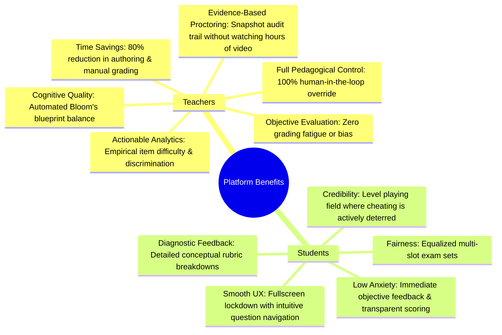
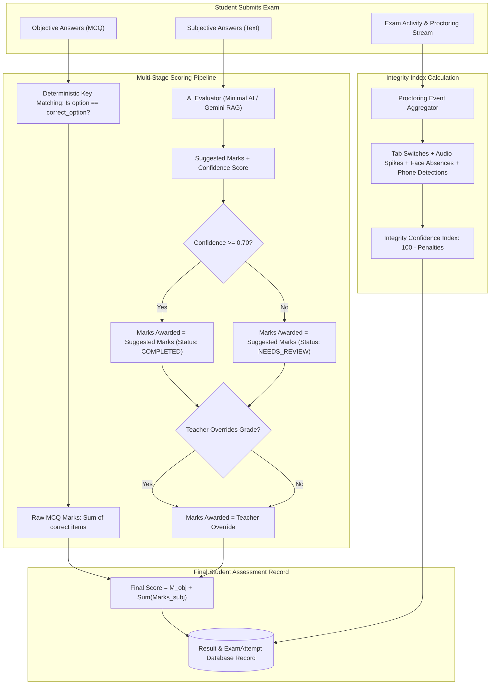
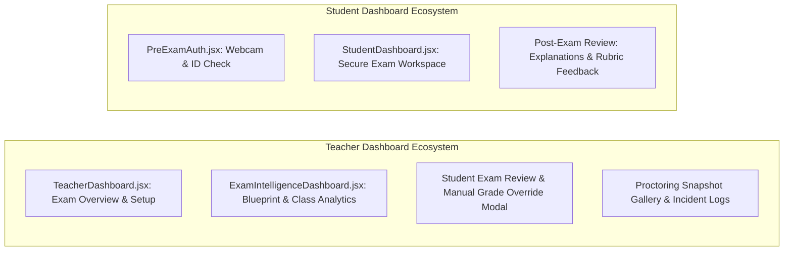

# Project Report: AI-Powered Intelligent Assessment & Proctoring System (QIS)
## File 3: Stakeholder Value Proposition & Exam Intelligence Dashboards

---

### 1. Value Proposition & Benefits for Educators and Learners

The platform transforms assessment from an administrative chore into a data-driven pedagogical feedback loop.



#### Detailed Breakdown of Benefits

#### A. For Teachers / Instructors
1. **Dramatic Reductions in Authoring Time**: Instead of writing dozens of balanced questions manually, teachers input high-level blueprint goals (e.g., 40% Algorithms, 30% Hard, 30% Apply) and let the Greedy Assembler or RAG Generator curate balanced assessments in seconds.
2. **Elimination of Subjective Grading Fatigue**: Long-form answers are pre-evaluated by semantic search and rubric concept matching. Teachers only need to inspect questions tagged with `NEEDS_REVIEW` ($<0.70$ confidence) or confirm pre-calculated marks, cutting grading time by over 75%.
3. **Objective Evaluation Consistency**: AI grading applies identical rubric criteria across all student submissions, removing unconscious bias, fatigue-based grade drift, or halo effects.
4. **Empirical Item Calibration**: Teachers can verify if a question intended to be "Easy" was actually answered correctly by students, highlighting confusing or poorly worded items.
5. **Auditable Integrity Records**: Instead of reviewing hours of raw webcam video, instructors get a curated gallery of timestamped violation snapshots (phone detection, tab-switch counts, facial absences) for targeted review.

#### B. For Students / Test-Takers
1. **Equalized Fairness Across Exam Slots**: When tests are administered across multiple time slots, the AI Slot Divider ensures all variants have equal aggregate difficulty, topic coverage, and cognitive depth, eliminating unfair sets.
2. **Transparent, Rubric-Based Feedback**: In the post-exam review, students don't just see a raw score—they receive explanations showing exactly which required concepts were present, partially addressed, or missed.
3. **Immediate Objective Results**: MCQs and factual questions are scored instantly upon submission, reducing post-exam anxiety.
4. **Protection for Honest Students**: Real-time browser lockdown and multi-modal proctoring protect against grade deflation caused by unproctored cheating peers.
5. **Clear, Guided Interface**: The exam workspace features auto-saving, color-coded question state trackers (Answered, Visited, Flagged), and countdown alerts to help manage time effectively.

---

### 2. Student Final Score Calculation & Exam Activity Tracking



#### Final Score Calculation Architecture
The final score is computed as:
$$\text{Final Score} = \sum_{i \in \text{MCQ}} \left( \mathbb{I}(\text{student\_opt}_i = \text{key}_i) \cdot \text{marks}_i \right) + \sum_{j \in \text{Subj}} \text{marks\_awarded}_j$$

Where:
- $\text{marks\_awarded}_j = \text{teacher\_override}_j$ if the teacher manually adjusts the score.
- $\text{marks\_awarded}_j = \text{ai\_suggested\_marks}_j$ if no manual adjustment is made.
- Every answer retains `ai_confidence`, `ai_model_name`, and `ai_explanation` for full auditability.

#### Exam Activities Monitored in Real Time
During an exam, the student interface continuously monitors key behaviors:

| Event Type | Detection Mechanism | Threshold / Rule | Severity |
| :--- | :--- | :--- | :--- |
| **Tab Switch / App Focus Lost** | Window `blur` & Page Visibility API | Triggered whenever window loses focus | High |
| **Fullscreen Breach** | HTML5 Fullscreen Change Event | Triggered when user exits fullscreen | High |
| **Face Missing** | OpenCV Haar Cascade (`analyze_frame`) | Absence continuous for $>5$ seconds | Medium |
| **Multiple Faces** | OpenCV Haar Cascade (`analyze_frame`) | $>1$ bounding box detected | High |
| **Unauthorized Device** | Ultralytics YOLOv8 (`analyze_frame`) | Cell phone / laptop detected (conf $>0.50$) | Critical |
| **Voice / Noise Level** | Web Audio API RMS volume analyser | Decibel level sustained above ambient floor | Medium |

---

### 3. Detailed Breakdown of System Dashboards

The user interface provides dedicated views tailored to each role's workflow.



#### A. Teacher Dashboard & Exam Intelligence Dashboard
1. **Blueprint Compliance Monitor**:
   - Compares the actual composition of the question bank against the defined blueprint in real time.
   - Displays percentage bars for Topic coverage, Difficulty balance, and Bloom’s Taxonomy alignment.
2. **Empirical Question Analytics**:
   - Identifies outliers by comparing predicted difficulty against actual student success rates.
   - Questions labeled "Easy" with low pass rates are highlighted as potentially ambiguous.
3. **Proctoring Audit Gallery**:
   - Rather than requiring instructors to watch video recordings, the dashboard presents a timeline of flagged events with high-resolution image snapshots, time of occurrence, and incident type.
4. **Subjective Grading Queue & Override**:
   - Filters answers by status (`NEEDS_REVIEW` vs `COMPLETED`).
   - Displays the question, reference answer, rubric, student answer, and the AI's suggested score and reasoning.
   - Teachers can adjust marks and add feedback with a single click (`routes/main_routes.py`, `override_grade`).

```
+---------------------------------------------------------------------------------------------------+
| TEACHER INTELLIGENCE DASHBOARD - EXAM #104: DATA STRUCTURES & ALGORITHMS                          |
+---------------------------------------------------------------------------------------------------+
|  [Summary Metrics]                                                                                |
|  Total Students: 64    |  Completed: 61    |  Avg Score: 78.4%    |  Avg Integrity Index: 96.2%    |
+---------------------------------------------------------------------------------------------------+
|  [Cognitive Blueprint Alignment]                                                                  |
|  Topic Coverage:     [======== Algorithms 40% ========][====== Trees 30% ======][== Graphs 30% =] |
|  Difficulty:         [== Easy (Target: 30%, Actual: 31%) ==][==== Medium (50%/48%) ====][Hard (20/21%)]|
|  Bloom Alignment:    Remember: 25% | Understand: 30% | Apply: 25% | Analyze: 15% | Evaluate: 5%   |
+---------------------------------------------------------------------------------------------------+
|  [Subjective Review Queue (Flagged for Teacher)]                                                  |
|  Student: Alice M. (Roll #204) | Question: "Explain AVL Tree rotations"                           |
|  AI Score: 3.5 / 5.0           | Confidence: 0.64 (LOW) | Status: [ NEEDS REVIEW ]                 |
|  Reasoning: Student explained Left-Right rotation but omitted balance factor equation.          |
|  Action: [ 3.5 ] [ Update Marks ] [ Add Comment ]                                                 |
+---------------------------------------------------------------------------------------------------+
|  [Proctoring Incidents Audit]                                                                     |
|  10:14:02 AM - Bob K.  - [ TAB_SWITCH ]      - Focus lost for 4 seconds                           |
|  10:22:18 AM - John D. - [ PHONE_DETECTED ]  - YOLOv8 Conf: 0.82 [ View Snapshot ]               |
|  10:31:05 AM - Sara L. - [ FACE_MISSING ]    - No face detected for 7 seconds [ View Snapshot ]   |
+---------------------------------------------------------------------------------------------------+
```

#### B. Student Exam Dashboard & Learning Analytics
1. **Pre-Exam Verification Panel (`PreExamAuth.jsx`)**:
   - Hardware check confirms working microphone and camera before access is granted.
   - Captures reference ID photo and baseline facial profile for proctoring comparison.
2. **Secure Testing Workspace (`StudentDashboard.jsx`)**:
   - Fullscreen lockdown prevents casual tab switching and distractions.
   - Color-coded question palette tracks progress: Green (Answered), Yellow (Visited), Grey (Unvisited).
   - Auto-saves responses on every option change and keystroke pause to prevent data loss.
3. **Transparent Post-Exam Feedback**:
   - Once published by the instructor, students can review their submission question by question.
   - Shows correct answers for MCQs with detailed explanations.
   - Shows AI explanations and rubric alignments for subjective questions, helping students understand where they earned or lost marks.

```
+---------------------------------------------------------------------------------------------------+
| STUDENT EXAM REVIEW - EXAM #104: DATA STRUCTURES & ALGORITHMS                                     |
+---------------------------------------------------------------------------------------------------+
|  Your Final Score: 84 / 100   |  Rank: 9 / 64   |  Status: Graded & Verified                      |
+---------------------------------------------------------------------------------------------------+
|  Question 1 (MCQ - 2 Marks) [ CORRECT ]                                                           |
|  "What is the worst-case time complexity of QuickSort?"                                           |
|  Your Selection: [x] O(n^2)   | Correct: O(n^2)                                                   |
|  Explanation: QuickSort degenerates to O(n^2) when pivot partitioning is unbalanced.             |
+---------------------------------------------------------------------------------------------------+
|  Question 2 (Subjective - 5 Marks) [ PARTIALLY CORRECT - Awarded: 4.0 / 5.0 ]                    |
|  "Describe the difference between BFS and DFS traversal and their space complexities."           |
|  Your Answer: "BFS uses a Queue and visits level-by-level, O(V) space. DFS uses a Stack/recursion |
|                and goes deep first, space complexity is O(h) where h is height."                  |
|  AI Feedback: "Accurate distinction between queue and stack structures. Correct identification of  |
|               space complexities for both balanced trees and general graphs."                     |
|  Rubric Points Matched: [x] Data Structures Used  [x] Traversal Logic  [x] Space Complexity        |
+---------------------------------------------------------------------------------------------------+
```

---
*Next Document: `docs/04_difficulty_bloom_topic_with_and_without_ai.md` for Comparative Technical Analysis of Classification & Selection.*

