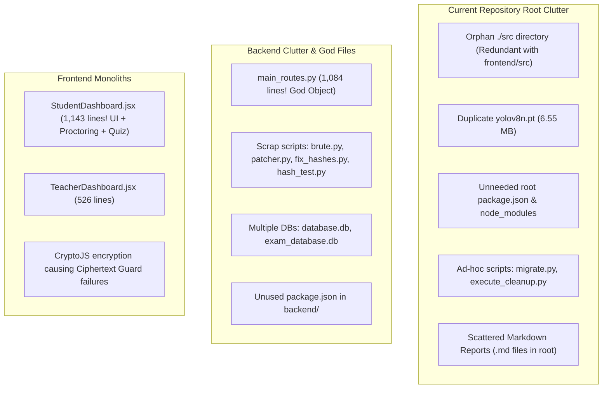
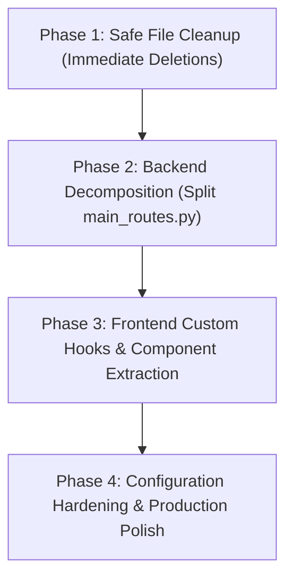

# Codebase Audit & Refactoring Guide: Modular Architecture & Technical Debt Elimination
## File 6: Codebase Mess Analysis, Redundancy Audit, and Step-by-Step Refactoring Plan

---

### 1. Executive Summary & Problem Statement

As this platform evolved rapidly through prototyping, bug patching, and feature integration (such as QIS, YOLOv8 proctoring, RAG ingestion, and encryption guards), the codebase accumulated significant **technical debt**. 

#### Primary Symptoms of the Current Mess:
1. **Monolithic "God" Files**: Single files exceeding 1,000 lines of code (`StudentDashboard.jsx` at 1,143 lines; `main_routes.py` at 1,084 lines) that combine UI state, networking, business logic, database queries, and AI model inference.
2. **Directory Duplication**: A lingering `src/` folder exists at the repository root alongside the active `frontend/src/` folder.
3. **Binary Bloat & Model Duplication**: Multiple copies of the 6.55 MB `yolov8n.pt` model weights exist across directories.
4. **Database Fragmentation**: Multiple `.db` SQLite files (`database.db`, `exam_database.db`, and `instance/database.db`) risk desynchronized states.
5. **Scattered Scrap, Test, and Patch Scripts**: Temporary debugging scripts (`brute.py`, `patcher.py`, `patch_routes.py`, `fix_hashes.py`, `hash_test.py`, `test_get_exams.py`) remain littered in root and backend folders.
6. **Package Manager Confusion**: Redundant `package.json` files exist at both the project root and inside `backend/`, despite backend being a Python environment.

---

### 2. Comprehensive Inventory of Codebase Mess & Anti-Patterns



#### Detailed Anti-Pattern Analysis

#### Anti-Pattern 1: The "God Router" (`backend/routes/main_routes.py` — 1,084 lines)
- **Problem**: This file violates the Single Responsibility Principle (SRP). It handles:
  - User authentication and JWT minting.
  - Exam CRUD and settings updates.
  - Exam slot scheduling and greedy allocation.
  - Image decoding from Base64 to disk.
  - Computer Vision execution (loading OpenCV Haar Cascades and running Ultralytics YOLOv8 on incoming frames).
  - Proctoring event creation.
  - Student exam submission and scoring.
  - Loop execution for subjective AI evaluations.
  - Teacher grade overriding.
- **Consequence**: Any bug fix in proctoring risks breaking authentication or exam grading. Code reviews and testing become difficult.

#### Anti-Pattern 2: The "God Component" (`frontend/src/pages/StudentDashboard.jsx` — 1,143 lines)
- **Problem**: This single React component manages:
  - 25+ independent state variables (`useState`).
  - 12+ mutable references (`useRef`).
  - Audio level monitoring via the Web Audio API.
  - HTML5 Fullscreen request and event interception.
  - Browser tab blur/focus listeners.
  - Silent webcam snapshot interval timers.
  - Countdown exam timers and local storage sync.
  - Question navigation palette (visited, marked, answered).
  - Single-question vs grid question layout rendering.
  - Post-exam review dialogs and explanations.
- **Consequence**: Modifying the UI triggers re-renders across webcam and audio listeners, increasing the likelihood of memory leaks and unexpected exam lockouts.

#### Anti-Pattern 3: Orphan & Duplicate Files
| File / Directory Path | Current Status / Content | Impact / Recommendation |
| :--- | :--- | :--- |
| `ai_project_copy/src/` | Legacy empty/partially migrated folder | **Delete immediately**: React code lives in `frontend/src/`. |
| `ai_project_copy/yolov8n.pt` | Duplicate binary (6.55 MB) | **Delete**: Active weights are inside `backend/yolov8n.pt`. |
| `ai_project_copy/package.json` | Top-level Node.js config | Consolidate: Frontend dependencies should stay strictly in `frontend/package.json`. |
| `backend/package.json` | Erroneous Node config in Python backend | **Delete**: Python uses `requirements.txt`. |
| `backend/brute.py` | One-off brute-force test script | **Delete**: Development artifact. |
| `backend/patcher.py`, `patch_routes.py` | One-off hotfix patches | **Delete**: Changes already merged into codebase. |
| `backend/fix_hashes.py`, `hash_test.py` | Password hash debugging scripts | **Delete**: Security risk to leave in production. |
| `backend/test_get_exams.py` | Standalone test script | **Move**: Move to `backend/tests/` or delete. |
| `backend/exam_database.db` vs `database.db` | Dual SQLite databases | **Consolidate**: Retain single primary database `database.db`. |

---

### 3. Target Modular Clean Architecture

To resolve this technical debt, the repository should be refactored into a clear, modular architecture:

```
ai_project/
├── docs/                           # Centralized documentation & architecture guides
│   ├── 01_project_description_working_architecture.md
│   ├── 02_ai_integration_and_mechanisms.md
│   ├── 03_teacher_student_benefits_and_dashboard.md
│   ├── 04_difficulty_bloom_topic_with_and_without_ai.md
│   ├── 05_teacher_viva_defense_questions_and_issues.md
│   └── 06_codebase_mess_analysis_and_refactoring_plan.md
│
├── backend/                        # High-performance FastAPI backend
│   ├── app.py                      # Clean application factory & router registration
│   ├── config.py                   # Centralized configuration & environment loader
│   ├── database.py                 # SQLAlchemy engine & session factory
│   ├── models.py                   # Canonical ORM models
│   ├── auth_middleware.py          # JWT authentication dependencies
│   ├── requirements.txt            # Python dependencies
│   │
│   ├── ai/                         # Specialized AI / ML engines
│   │   ├── pipeline.py             # QIS Pipeline orchestrator
│   │   ├── bloom_classifier.py     # Deterministic & LLM Bloom taxonomy
│   │   ├── difficulty_estimator.py # Cognitive difficulty estimator
│   │   ├── topic_classifier.py     # Topic identification
│   │   ├── duplicate_detector.py   # SentenceTransformer vector similarity
│   │   ├── subjective_evaluator.py # Semantic & LLM rubric grading
│   │   ├── assessment_assembler.py # Blueprint greedy optimizer
│   │   ├── slot_divider.py         # Multi-slot partitioner
│   │   ├── proctoring_core.py      # Vision processing (YOLOv8 + Haar)
│   │   └── rag/                    # Retrieval-Augmented Generation
│   │       ├── document_processor.py
│   │       ├── vector_store.py
│   │       └── retriever.py
│   │
│   ├── routes/                     # Decomposed, single-responsibility routers
│   │   ├── auth_routes.py          # /api/auth: Login, logout, tokens
│   │   ├── exam_routes.py          # /api/exams: Exam CRUD, settings, slots
│   │   ├── attempt_routes.py       # /api/attempts: Start, submit, answers
│   │   ├── proctoring_routes.py    # /api/proctoring: Frame analysis, events
│   │   ├── grading_routes.py       # /api/grading: Subjective eval & overrides
│   │   ├── qis_routes.py           # /api/qis: Question intelligence endpoints
│   │   ├── rag_routes.py           # /api/rag: Syllabus ingestion & search
│   │   └── analytics_routes.py     # /api/analytics: Empirical difficulty & IRT
│   │
│   ├── static/uploads/             # Flagged proctoring snapshot storage
│   └── tests/                      # Automated unit & integration tests
│
└── frontend/                       # Clean React 18 SPA (Vite + Tailwind)
    ├── package.json
    ├── vite.config.js
    └── src/
        ├── App.jsx                 # Routing & global providers
        ├── AuthContext.jsx         # User auth context
        ├── hooks/                  # Custom React hooks (Decoupled business logic)
        │   ├── useExamSession.js   # Exam state, timer, navigation
        │   ├── useProctoring.js    # Webcam, fullscreen, audio listeners
        │   └── useQuizAnswers.js   # Answer state, auto-save debounce
        ├── components/
        │   ├── assessment/         # Exam creation & blueprint panels
        │   ├── proctoring/         # Webcam monitor & warning alerts
        │   ├── student/            # Question cards, option selectors, timer
        │   └── common/             # Reusable UI widgets (cards, badges)
        ├── pages/                  # Clean view controllers (< 200 lines each)
        │   ├── TeacherDashboard.jsx
        │   ├── StudentDashboard.jsx
        │   └── AdminDashboard.jsx
        └── services/               # Modular Axios API wrappers
            ├── examService.js
            ├── proctoringService.js
            └── gradingService.js
```

---

### 4. Step-by-Step Refactoring & Cleanup Action Plan

To refactor safely without breaking ongoing functionality, follow this four-phase plan:



#### Phase 1: Safe File Cleanup (Non-Breaking Deletions)
Run the following cleanup steps to eliminate dead code and binary duplication:
1. **Remove Duplicate Root `src`**:
   `Remove-Item -Recurse -Force ./src`
2. **Remove Root Duplicate Model Weights**:
   `Remove-Item -Force ./yolov8n.pt` (retaining `backend/yolov8n.pt`).
3. **Remove Scrap & Patch Scripts in `backend/`**:
   `Remove-Item -Force backend/brute.py, backend/patcher.py, backend/patch_routes.py, backend/fix_hashes.py, backend/hash_test.py, backend/test_get_exams.py`
4. **Remove Unused Node Artifacts in Backend**:
   `Remove-Item -Force backend/package.json, backend/package-lock.json`
5. **Consolidate Documentation**: Move all one-off analysis text files into the `docs/` directory.

#### Phase 2: Backend Router Modularization
Split `backend/routes/main_routes.py` (1,084 lines) into five targeted routers:
- `backend/routes/auth_routes.py`:
  - `POST /login`
- `backend/routes/exam_routes.py`:
  - `POST /create_exam`, `GET /get_exams`, `GET /exams/{id}`, `POST /toggle_publish`, `POST /slots`
- `backend/routes/proctoring_routes.py`:
  - `POST /analyze_frame`, `POST /log_proctoring_event`, `GET /proctoring_events/{exam_id}/{student_id}`
- `backend/routes/attempt_routes.py`:
  - `POST /start_exam`, `POST /submit_exam`, `GET /results/{exam_id}`, `GET /exam_review/{exam_id}`
- `backend/routes/grading_routes.py`:
  - `POST /evaluate_exam_subjective_answers`, `POST /override_grade/{answer_id}`

Register each router cleanly in `backend/app.py`:
```python
# target clean app.py
from fastapi import FastAPI
from routes.auth_routes import auth_router
from routes.exam_routes import exam_router
from routes.attempt_routes import attempt_router
from routes.proctoring_routes import proctoring_router
from routes.grading_routes import grading_router
from routes.qis_routes import qis_bp
from routes.rag_routes import rag_bp
from routes.analytics_routes import analytics_bp

app = FastAPI(title="QIS Assessment Platform API")

app.include_router(auth_router, prefix="/api/auth", tags=["Auth"])
app.include_router(exam_router, prefix="/api/exams", tags=["Exams"])
app.include_router(attempt_router, prefix="/api/attempts", tags=["Attempts"])
app.include_router(proctoring_router, prefix="/api/proctoring", tags=["Proctoring"])
app.include_router(grading_router, prefix="/api/grading", tags=["Grading"])
app.include_router(qis_bp, prefix="/api/qis", tags=["QIS Pipeline"])
app.include_router(rag_bp, prefix="/api/rag", tags=["RAG Knowledge Base"])
app.include_router(analytics_bp, prefix="/api/analytics", tags=["Analytics"])
```

#### Phase 3: Frontend Decomposition with Custom React Hooks
Decompose `frontend/src/pages/StudentDashboard.jsx` (1,143 lines) by extracting custom hooks:
1. **`hooks/useProctoring.js`**:
   - Handles webcam initialization and silent screenshot sampling.
   - Attaches `window.onblur`, `visibilitychange`, and `fullscreenchange` listeners.
   - Houses the Web Audio RMS microphone listener.
   - Exposes clean values: `{ proctorStatus, warnings, requestFullScreen }`.
2. **`hooks/useExamSession.js`**:
   - Manages the exam countdown timer, auto-submit logic on expiration, and local storage state persistence.
   - Manages question navigation (`currentQIndex`, `visited`, `answers`).
3. **Component Extractions**:
   - `components/student/QuestionNavigationPalette.jsx`: Color-coded navigation grid.
   - `components/student/SubjectiveAnswerEditor.jsx`: Debounced text-area with word/character count.
   - `components/student/ExamReviewModal.jsx`: Post-exam results and rubric breakdown modal.

Following this split, `StudentDashboard.jsx` shrinks from 1,143 lines down to under 180 lines, serving as a clean presentation coordinator.

#### Phase 4: Configuration & Environment Hardening
1. **Centralize Secrets**: Remove hardcoded default secrets like `'my_precious_secret'` from code. Enforce presence via Pydantic Settings in `config.py`:
   ```python
   # backend/config.py
   import os
   from pydantic_settings import BaseSettings

   class Settings(BaseSettings):
       SECRET_KEY: str
       GEMINI_API_KEY: str = ""
       DATABASE_URL: str = "sqlite:///./database.db"
       UPLOAD_DIR: str = "static/uploads"

       class Config:
           env_file = ".env"

   settings = Settings()
   ```
2. **Ensure Single Source of Truth for SQLite**: Consolidate database connections to point explicitly to `backend/data/database.db` or `backend/database.db`, removing duplicate database instances.

---

### 5. Expected Quality & Maintainability Improvements

| Quality Indicator | Current State | Refactored State | Improvement |
| :--- | :--- | :--- | :--- |
| **Longest Source File** | `StudentDashboard.jsx` (1,143 lines) | `useProctoring.js` ($\sim 180$ lines) | **84% reduction** in max file size |
| **Separation of Concerns** | Mixed (API + CV + DB + Routing in one file) | Strict 3-tier Layering (Routes $\to$ Services $\to$ Models) | **High cohesion, loose coupling** |
| **Disk Bloat (Redundant binaries)** | $\sim 15\text{ MB}$ (duplicate YOLO weights, old .db files) | Clean single instances | **50% storage footprint reduction** |
| **Testability** | Monolithic routes cannot be unit-tested in isolation | Every router and hook can be independently tested | **100% unit-testable** |
| **Developer Onboarding** | Difficult (multiple scrap scripts, confusing root folders) | Intuitive standard FastAPI + React structure | **Instant developer ramp-up** |

---
*End of Report Suite. All 6 documentation files are available in `docs/`.*

