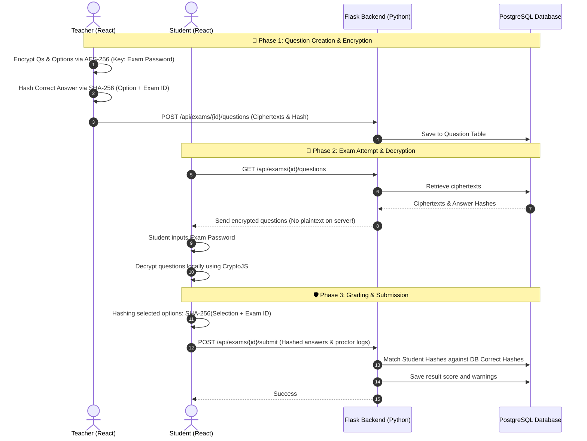
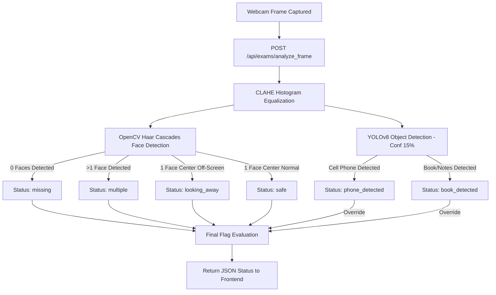
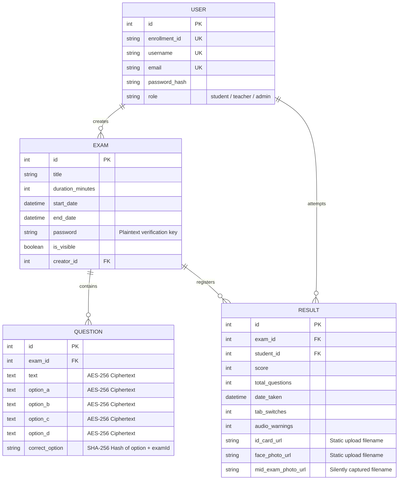

# Project Analysis: AI-Proctored & E2E Encrypted Exam Platform

This project is a state-of-the-art **Web-based Exam & Quiz Platform** featuring dual-layered integrity: **Client-side End-to-End (E2E) Zero-Knowledge Encryption** for exam content and **Real-time AI Video/Audio Proctoring** to detect cheating.

---

## 🛠️ Technology Stack

| Layer | Technology | Primary Purpose |
| :--- | :--- | :--- |
| **Frontend** | React (Vite) | Single Page Application framework providing interactive student & teacher dashboards. |
| | Tailwind CSS | Sleek, modern, and responsive user interface styling. |
| | CryptoJS | Client-side AES-256 encryption/decryption & SHA-256 answer hashing. |
| | React-Webcam | Webcam frame capturing for pre-exam auth and mid-exam proctoring. |
| **Backend** | Python Flask | RESTful API server. |
| | SQLAlchemy | Object-Relational Mapping (ORM) connecting to PostgreSQL. |
| | OpenCV | Image preprocessing, CLAHE formatting, and Haar Cascade face detection. |
| | Ultralytics YOLOv8 | Deep learning object detection model detecting cell phones and books/notes. |
| **Database** | PostgreSQL | Relational database (`intranet_exam_db`). |

---

## 📐 System Architecture & Data Flow

Below is the workflow showing how questions are created, encrypted, stored, fetched, decrypted, and securely graded without the server ever seeing the plaintext content or the answers.



---

## 🔒 Security & Cryptographic Integrity (Zero-Knowledge)

The platform implements a **Zero-Knowledge Architecture**. The backend database and server admin cannot view the questions or know the correct answers.

1. **E2E Question Encryption**:
   - When a teacher creates questions or uploads a CSV, the frontend parses the text.
   - Using `CryptoJS.AES.encrypt(text, examPassword)`, the text and choices (A, B, C, D) are converted to AES-256 ciphertexts.
   - Only the ciphertexts are sent to `/api/exams/<exam_id>/questions`.
2. **Cryptographic Grading (No Plaintext Leak)**:
   - Instead of storing correct options as `"A"` or `"B"` which would expose the answer, the frontend hashes the correct option combined with the exam ID: `SHA-256(option + examId)`.
   - When a student takes the exam, they submit a map of `question_id -> SHA-256(student_selection + examId)`.
   - The backend counts correct answers simply by executing:
     ```python
     score = sum(1 for q in questions if user_answers.get(str(q.id)) == q.correct_option)
     ```
     This allows grading without the server decrypting any content or knowing the option characters.

---

## 🧠 AI Proctoring & Anti-Cheating Engine

The proctoring system operates client-side for immediate warning feedback and server-side for heavy machine learning inference.

### 1. Computer Vision Proctoring (YOLOv8 + OpenCV Haar Cascades)
Every **2 seconds**, the student's browser takes a screenshot of their webcam feed and POSTs it to `/api/exams/analyze_frame`.



- **Face Bounding Check**: 
  - Standardizes the image to `640px` width.
  - Applies **CLAHE (Contrast Limited Adaptive Histogram Equalization)** to sharpen facial features under low/uneven lighting.
  - Detects faces using OpenCV's frontal face Haar Cascade.
  - If no face is found for more than 3 seconds $\rightarrow$ `missing`.
  - If multiple faces are found $\rightarrow$ `multiple`.
  - If a single face's horizontal center drifts outside of the center region `[width // 4, 3 * width // 4]` $\rightarrow$ `looking_away`.
- **YOLOv8 Object Detection**:
  - The frame is passed to the **YOLOv8 Nano** (`yolov8n.pt`) neural network.
  - Evaluates Class `67` (Cell Phone) and Class `73` (Book) at a low confidence threshold of `0.15` to preemptively catch phone/book cheating.
  - Phone and Book detections override face location status flags.

### 2. Audio Proctoring
- Accesses microphone using the browser's Web Audio API.
- Measures the frequency bin averages. If the volume levels spike above a threshold of `45` for longer than 4 seconds, the system logs an **Audio Warning**.
- Displays an alert: `🎤 AUDIO WARNING: Loud noise or talking detected in your environment!`.

### 3. Client-Side Browser Lockdowns
- **Tab-switching & Window Blurring**: Monitored via the document `visibilitychange` and window `blur` events. Triggers warning immediately.
- **Full-Screen Enforcement**: The exam component forces browser full-screen on launch. Exiting full-screen triggers a violation warning.
- **Hard Blockers**:
  - Disables mouse right-click context menus (`contextmenu`).
  - Disables copy, cut, paste actions (`copy`, `cut`, `paste`).
  - Intercepts keyboard combinations (e.g. `Ctrl+C`, `Ctrl+V`, `Ctrl+X`).
  - Listens to `beforeunload` to prevent accidental tabs closure or refreshes.
- **Auto-Submission**: If a student accumulates **3 warnings**, the exam auto-submits.

---

## 👥 User Roles & Permissions

1. **Admin**:
   - Accesses System Stats (User, Exam, Result counts).
   - Manages Users (creates/deletes students, teachers, and admins).
2. **Teacher**:
   - Manages exams they created.
   - Inputs questions manually or uploads bulk questions via a CSV template.
   - Accesses student exam results and proctoring reports (visual review of pre-exam ID card, face photo, and the mid-exam secret photo).
3. **Student**:
   - Views open assessments.
   - Authenticates identity (ID card + face scan) prior to entry.
   - Takes the exam under proctored browser lockdown.

---

## 🗄️ Database Schema Details

The database structure consists of four main tables:



---

## 🚀 Execution & Setup Instructions

### Database Setup & Migration
Before running the backend, database tables need to be created/updated.
```powershell
# Drop old tables and seed admin user (admin / adminpass)
python backend/fix.py

# Upgrade columns to TEXT for zero-knowledge strings
python backend/update_schema.py
```

### Start Backend (Flask)
Runs on port `5000` by default. Make sure a PostgreSQL server is running and database configuration in `backend/config.py` is configured.
```powershell
python backend/app.py
```

### Start Frontend (Vite + React)
Runs on port `5173`.
```powershell
cd frontend
npm install
npm run dev
```
